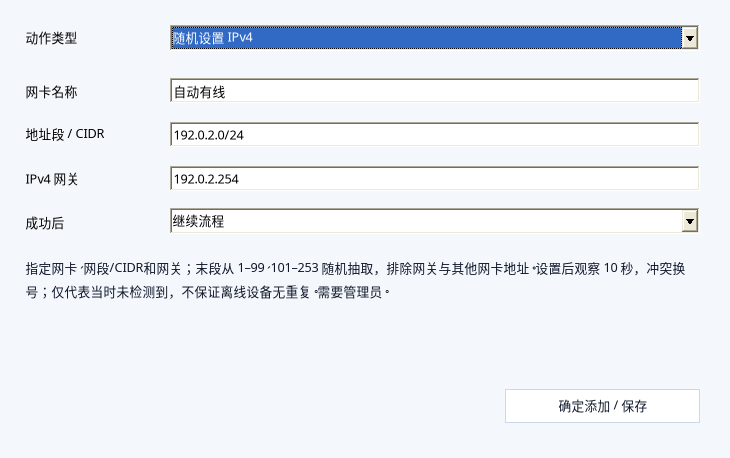
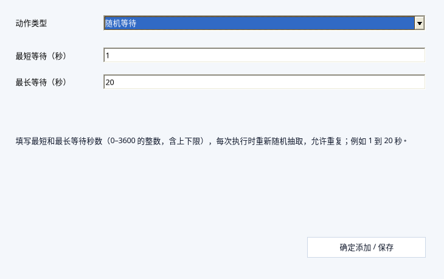
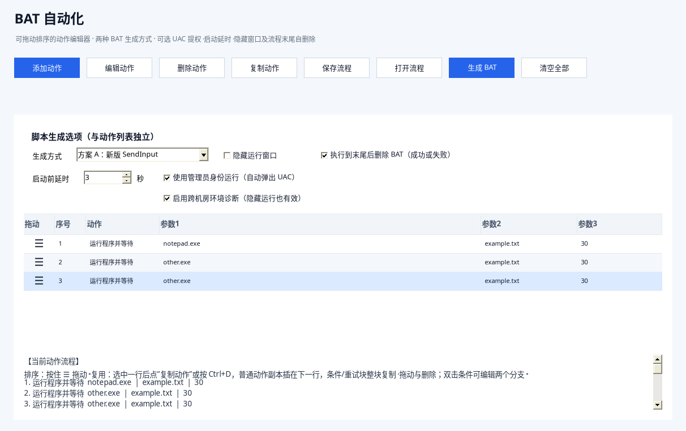

# WinForms BAT 自动化独立版 V0.6.0-BAT

从 [WinForms v0.6.0](https://github.com/dayazilaile/WinForms/tree/v0.6.0) 提取的独立 Windows 程序。打开直接进入 BAT 编辑器，运行只需 **WinForms-BAT.exe**，不依赖原工具箱、数据库目录或额外 DLL。发布使用独立 tag `v0.6.0-BAT`，与项目 v0.6.0 同步。

## V0.6.0 WinForms 命名统一

运行根目录WinForms-BAT.exe，窗口、属性、工作流、BAT启动提示及新网络备份名称使用WinForms，数字版本0.6.0。源码从同版主程序重新提取，共13个原样共用文件，完整C#源码17个文件；不需要原项目的数据库或额外DLL。

旧工作流仍可导入，原有自动化/便携日志/运行库检查保留。版本按0.6.0→0.6.1…0.6.23→0.7.0推进，release-policy.json与tools/next_version.py记录相同规则；独立标签追加-BAT。Server定版不更新。

云端135项检查通过，Windows/输入/硬件/杀软实机仍需验收。本版不使用整体“离线版/本地离线运行”描述。

## V0.5.22 编译与运行库检测修正

程序最低.NET Framework 4.5，4.8仅推荐；已按微软4.5引用程序集编译并核对成品类型归属。Check_Runtime.bat读取双视图及原生回退，显示实际Release与版本。读取失败不会直接写成“已知版本低”。

完整解压后运行Build_And_Run.bat；仍有提示时运行Diagnose_Runtime.bat查看只读输出。确实缺少最低运行库时需装官方组件。Win7仍需SP1，生成BAT仍需PowerShell5.1（该组件自身需要.NET4.5.2）。

133项云端检查通过；Windows批处理七场景已接入tests/Run-Windows.ps1，尚未在本Linux云端执行，旧Windows/CLR实测仍需验收。Server冻结包不变。

## V0.5.21 网络操作身份日志

包含网络设置动作的 BAT 在自身目录的 Logs/network-operations-v1.tsv 写入19列中文表格：时间/时区、主机名、设备标识/来源、硬件UUID、BIOS序列号、每张网卡的MAC/IP/掩码/DHCP/网关/DNS、账户/权限、系统/版本、会话/操作编号、阶段/结果/耗时/详情。

记录开始、结束、请求目标和修改前后；随机IP另记占用、换号和恢复。不可写时停止后续网络步骤，不回退TEMP；结束日志失败时设置可能已经生效，应核对实际状态。硬件标识可能缺失或重复，不将某一MAC当作不可伪造的整机身份。密码、输入文字和输出全文不写入日志。

纯输入/等待BAT不新增文件日志；共享源码从工具箱同版重新复制，共12个，独立程序仍只需一个EXE，全部源码16个文件。133项云端检查及PowerShell模拟通过，Windows/硬件/杀软实测仍需验收。Server保持v0.5.20-Server定版。

## V0.5.20 Win7 基线与便携备份

Win7 SP1/10/11 需要 .NET Framework 4.8 或更新的 4.x，生成 BAT 需要 Windows PowerShell 5.1。旧系统缺少 NetTCPIP 时，DNS/静态或随机 IPv4/网关/DHCP 自动化会在修改前拒绝；基础输入、分支、等待等保留。系统清单和运行库前置检查与工具箱同步。

网络动作原有配置备份改存 BAT 所在目录的 Logs，不用 TEMP；独立编辑器不额外保存执行日志。软件目录/脚本目录不可写时不回退用户目录。保存工作流/报告仍由保存窗口决定。不能保证清除 Windows、卸载器或杀软自己的记录。

本次共 11 个源文件直接复用工具箱（含运行库检查），总计 15 个 C# 源文件。仍只需单个 EXE 打开编辑器。131 项云端检查通过，但真实 Win7/Server 与 360/火绒未验证；用户尚未测试 v0.5.19。Server 定版另提供工具箱 v0.5.20-Server，独立版不混入其他模块。

## V0.5.19 随机设置 IPv4

入口：**BAT 自动化 → 添加动作 → 随机设置 IPv4**。仍导出一个 BAT；工具箱与 [v0.5.20-BAT 独立版](https://github.com/dayazilaile/WinForms/archive/refs/tags/v0.5.20-BAT.zip) 使用相同自动化代码。

| 填写项 | 示例 | 说明 |
| --- | --- | --- |
| 网卡名称 | 自动有线 | 也支持自动无线，或准确网卡名（如以太网）；自动模式必须唯一匹配已连接的物理网卡。 |
| 地址段 / CIDR | 192.168.1.0/24 | 可简写 192.168.1；不写掩码默认为 24，支持 8–30 位。固定输入地址的前三段，只随机末段。 |
| IPv4 网关 | 192.168.1.254 | 必须是同一子网内的有效主机地址，自动从候选中排除。 |
| 成功后 | 继续流程 / 结束脚本 | 前者执行后面的动作；后者立即结束整个流程，包括当前嵌套分支/重试。两者都走原来的 BAT 收尾及自删除设置。 |

末段只从 **1–99、101–253** 随机抽取；不使用 0、100、254、255，也排除实际子网的网络/广播地址、网关和本机其他网卡地址。比如 `172.26.8.0/20` 搭配 `172.26.0.1`，只在 `172.26.8.*` 中抽取；`192.168.1.128/25` 会进一步排除不属于该子网的候选。

每次随机选择尚未尝试的地址，先查 ARP/邻居占用证据，再设置静态 IPv4 并观察 Windows 重复地址检测 **10 秒**。发现占用或 Duplicate 就换号；完整观察后需成为 Preferred，且确认掩码、静态模式和网关才算成功。10 秒是一次设置后的观察时间，查询、设置与冲突重试另计。**Ping 无回应不代表地址空闲；关机、未响应设备或网络限制仍可能造成漏检，不能保证绝无冲突。**

本动作需要管理员权限，沿用现有正常 UAC 选项；不增加隐藏进程或防护排除。修改本机地址可能中断正在进行的远程连接。开始前检查连接、原配置和 DAD 状态；网卡未连接、关闭重复地址检测、多 IPv4 或多条默认路由时停止，不猜测应覆盖哪一项。候选只尝试一轮，耗尽或配置异常即停止后续流程，并尝试恢复原 DHCP 模式或原单个静态地址/网关；恢复失败明确提示。恢复 DHCP 不保证立即取得原租约。脚本不写 DNS 设置，不为这个动作留下配置备份/报告文件。

先更新工具箱再重新提取独立包，10 个共用源码文件逐字节相同。云端通过工具箱 **474 项**、独立版 **131 项**检查；另实际执行 PowerShell 模拟用例，核验占用跳过、Duplicate 换号、失败恢复及两种成功方式。网络系统调用、时间、管理员状态均由测试替代，未修改云端网卡；未完成真实 Windows 网络与火绒实机验收，不能保证不提示。

## V0.5.18 共享封装回归

工具箱的清理脚本与 BAT 自动化改为共用 BatScriptPackage；独立版同步重新提取同一自动化代码与该模块。96 组原有自动化导出的完整 BAT 与改动前逐字节一致，保留所有设置和默认值。独立版不包含软件清理功能，因此无需 Scripts 模板文件，运行仍只需 WinForms-BAT.exe。

该重构不能代替火绒实测，也不保证所有安全产品无提示；主程序告警审查限于工具箱，不能把源代码/功能通过当作杀毒检测结论。

## 沿用 V0.5.15 的两分钟等待与判断超时收尾

- **等待窗口**：参数 1 为窗口标题关键词，参数 2 为超时秒数，默认 **120 秒**，可填 1～120。超过时限仍未出现窗口，停止后续动作，返回失败并进入 BAT 收尾，不再额外等待 15 秒。
- **条件判断**：文件存在、网络可达、系统版本的单次判断最多等 120 秒；判断超时、报错或结果不明确时终止流程，不进入任一分支，也不重复执行外层重试。明确为“是/否”时继续走原来的成立/否则分支；Ping 无回应仍可作为否，不表示一定断网。
- **自动删除**：保留“执行到末尾后删除 BAT（成功或失败）”选项。勾选时，超时/异常返回后自动尝试清理；可见模式继续在当前黑框内完成，不新增隐藏清理进程。未勾选时保留文件并暂停；文件锁、权限或防护拦截仍可能导致删除失败并显示警告。
- 该时限只约束等待窗口及条件求值，不限制整个流程总时长；固定等待、随机等待和显式程序等待保持各自设置。判断通过进程内 PowerShell 实例限时执行，不另开判断进程；超时请求异步取消，不等待可能阻塞的同步停止/释放。

**旧流程请注意**：参数 2 留空时新版默认 120 秒；若原来明确填了 `15`，请改为 `120`。大于 120 的旧设置需先调整到 1～120 才能生成。更新程序后重新生成 BAT，旧 BAT 不会自行更新。保持不勾选隐藏、勾选末尾删除即可沿用上一版的可见清理方式。

已统一异常退出并回归检查，避免错误被吞掉后误报成功或继续动作；Windows 原生 cmd/UAC/输入与火绒兼容性仍需实机验收。新增脚本运行用例在 Linux PowerShell 7.4.13 实际执行，超时用例缩短到 1 秒验证机制，没有宣称在 Windows 上完成两分钟实测。

## 沿用 V0.5.14 的可见窗口内完成自删除

针对运行结束时火绒提示“隐藏执行 PowerShell”的反馈，移除**可见模式**末尾自删除所启动的隐藏 PowerShell 清理进程，改由当前 cmd 窗口同步删除正在运行的这个 BAT。运行期间保留黑框，无额外隐藏清理窗口或后台清理任务。

- 保留单个 BAT、自动 UAC、鼠标/键盘、诊断、随机等待、全部动作及“执行到末尾后删除 BAT（成功或失败）”选项，默认仍启用自删除；隐藏运行默认不勾选。
- 删除和退出放在 cmd 预先读取的同一个括号块内，避免文件删除后读取后续命令失败；保留流程原本的退出码。仅删除当前 BAT，文件名按完整路径加引号处理，关闭延迟变量展开。
- 删除失败会在当前窗口输出警告，不伪报已删除；不勾选自删除时仍保留文件并暂停。取消/提权失败不会进入清理。
- **使用方式：不勾选“隐藏运行窗口”，按需要勾选末尾删除，再重新生成 BAT。** 旧 BAT 不会自动更新。手动勾选隐藏模式仍沿用原有隐藏执行实现，安全软件可能继续提示。

截图提示的防护项目为“隐藏执行 PowerShell”，与旧清理代码吻合；这不能证明所有安全检测只针对该行为。云端没有火绒或 Windows 实机，本次不承诺所有机器不再提示。没有关闭防护、添加排除项或采用混淆；工作流主体仍沿用原有编码执行结构。

## 沿用 V0.5.13 的启动代码审查与兼容性改进

保留单个 BAT、自动申请管理员、鼠标/键盘、两种输入引擎、隐藏运行、诊断、末尾自删除、条件/重试和随机等待，原有界面选项与默认勾选不变。

- 自动提权和隐藏运行的启动段从 `-EncodedCommand` 改为可直接审阅的 `-Command`；自动提权仍使用 Windows 标准 `RunAs` 和正常 UAC 同意，不绕过 UAC。已是管理员时继续当前实例，取消或失败时报告并停止，不降权继续执行。
- BAT 路径通过环境变量传递，不拼入 PowerShell 源码；提权直接使用文件关联打开 BAT，减少一层手工拼接的 cmd 参数。
- 没有输入动作且关闭诊断时，不编译无用的输入桥接；只有激活窗口的流程才创建其需要的 WScript.Shell。鼠标动作、物理 DPI 处理、传统中文剪贴板输入和诊断仍保留。
- **这是代码透明度和兼容性改进，不是已验证的火绒拦截修复。** 工作流主体仍沿用原有单 BAT 的 Base64 编码与 ScriptBlock 执行结构，没有宣称完全明文，也没有新增混淆、加密或关闭安全软件的操作。现有自删除和隐藏运行仅按所选选项生成。

对用户提供的 BAT 已做不执行样本的静态审查，并与原版生成器核对；没有发现该样本含下载、额外植入或未知动作。当前云环境没有火绒或可用的病毒库，不能据此证明文件无毒或保证不再拦截。详见 [审查记录](docs/bat-review-v0513.md)。更新生成器后需要重新生成 BAT；旧 BAT 不会自行变化。

## 沿用随机等待

在“添加动作”中选择 **随机等待**，填写：

| 字段 | 示例 |
| --- | --- |
| 最短等待（秒） | 1 |
| 最长等待（秒） | 20 |

每次执行到此动作时，从 1～20 秒（含上下限）中重新抽取一个整数秒数，允许重复；不是在生成 BAT 时固定。重试中的每次执行也重新抽取。可见控制台会显示本次抽到的秒数。

默认 1～20 秒，支持 0～3600 整数秒，上下限相同即固定等待；范围错误会提示。原“等待毫秒”保持不变。启动前延时及其他等待动作另计。新旧流程格式兼容，但包含新动作的流程应使用新版软件。

可打开 [随机等待示例](examples/随机等待示例.workflow.txt) 查看 1～20 秒的设置。该示例只等待，不申请管理员或自删除。

## 沿用独立版框架兼容性修复

当前使用微软 .NET Framework 4.5 引用程序集和最终 EXE 类型归属检查，保留 v0.5.11-BAT 对旧包 Stack<T> 类型加载失败的修复。构建记录见 [BUILD_INFO.json](BUILD_INFO.json)。Windows 验收会直接测试包内 EXE，然后再测试重新编译的 EXE。

## 下载后怎么用

1. 完整解压本包，双击根目录 **WinForms-BAT.exe**。适用 Windows 7 SP1 / Windows 10 / Windows 11；最低 .NET Framework 4.5，建议 4.8，生成 BAT 另需 Windows PowerShell 5.1。
2. 点击 **添加动作**，选择类型并填写参数；用 ☰ 拖动排序，或通过 **复制动作 / Ctrl+D** 复用。
3. 点击 **保存流程** 保存可继续编辑的 `.workflow.txt`；**打开流程** 可以读取原工具箱保存的流程。打开流程不会执行其中动作。
4. 选择生成方式、启动延时等选项，再点 **生成 BAT**。生成的 BAT 可独立运行，目标电脑无需安装本程序。

根目录附预编译 EXE；若要从源码重新编译，运行 **Build_And_Run.bat**，编译后启动 `build\WinForms-BAT.exe`。仅编译可运行 `Build_Only.bat`。移动编译后的程序只需复制 EXE，无需 Database 文件夹。

预编译 EXE 使用 C# 5 和微软 .NET Framework 4.5 引用程序集，云端已检查成品类型引用并完成模拟界面测试。GitHub Actions 会直接运行包内发布 EXE 的测试，再编译并测试 Windows csc 版本；应以实际任务结果为准。当前云端仍不能代替 Windows 实机、输入权限和高 DPI 验收。

## 保留的功能

- 程序启动/等待、等待与激活窗口、鼠标移动/点击/滚轮、按键组合、中文输入。
- 鼠标物理坐标捕获、3 秒后测试移动、键盘录入、已打开/最小化窗口选择。
- 两种 BAT 引擎：新版 SendInput、传统兼容（临时剪贴板粘贴中文）。
- 启动前延时、隐藏运行、管理员 UAC、跨机房环境诊断、执行末尾删除 BAT；选项随工作流保存。
- 文件存在、网络可达和系统 Build 条件，**条件成立时执行 / 条件不成立时执行** 两栏，可添加多个动作、编辑与排序；保存自动补齐否则和结束条件。
- 嵌套条件、失败重试、程序等待与退出码检查；条件/重试块整体复制、拖动和删除，最多嵌套 8 层。
- 原有 DNS、网关、静态 IP/DHCP 等自动化动作和原有文件操作动作，保留参数校验与相应确认。

界面预览使用测试样例，没有执行图片里的程序或网络检测：

## 条件怎么填写

以“如果网络可达”为例：目标填一个真实 IP 或主机名；左栏放有回应时执行的动作，右栏放没回应时执行的动作。无需执行的一边可留空，至少一边应有动作。Ping 无回应也可能是目标禁止 ICMP，并不能直接认定断网。

文件条件填写完整文件路径；系统条件填写 Windows Build 下限和可空的上限，例如 22000–26100。取消编辑不改变原流程，双击主流程的条件可重新进入两栏。

可先通过“打开流程”载入 [条件分支示例](examples/条件分支示例.workflow.txt)：检查 `C:\Windows\explorer.exe` 是否存在，分别等待 1000/500 毫秒；示例不包含删除、格式化或网络修改动作。

## 执行选项与原版保持一致

程序编辑时不执行动作，生成 BAT 后由运行者启动。管理员选项控制 BAT 启动时的 UAC，编辑器本身不自动提权。自删除表示流程到达末尾后尝试删除 BAT，成功或失败都可能走到末尾。

鼠标坐标使用物理像素，缩放/分辨率或显示器布局变更后应重新抓取；输入和窗口激活仍受交互会话、焦点及权限影响。原有网络修改需要管理员，格式化动作不能隐藏运行，清理/格式化动作不能放入自动重试块。独立版沿用原版的这些边界。

## 编译、测试与来源

- 完整源码位于 `src/`，共 17 个文件；自动化引擎、条件编辑、坐标、键盘与窗口选择模块直接沿用 v0.5.20。精确来源及 SHA-256 见 [SOURCE_PROVENANCE.json](SOURCE_PROVENANCE.json)。独立入口、窗口外壳及两个纯辅助方法位于适配文件中。
- Windows 编译：`Build_Only.bat --no-pause`；验收：`powershell -NoProfile -ExecutionPolicy Bypass -File tests\Run-Windows.ps1`。
- 当前云环境通过 **135 项检查（引擎/流程 98 + 独立界面 33 + 成品引用兼容性回归 4）**：工作流兼容、两种 BAT 导出、条件分支、嵌套/重试/深拷贝、模拟鼠标回放，以及在只放 EXE 和测试程序的空目录里打开独立界面。
- 新增范围校验、含上下限、相等边界、运行时脚本、重试内抽取、保存与界面编辑测试；Windows 随机用例拦截等待并验证反复抽取，不实际休眠。
- 测试没有执行用户程序、真实 Ping、输入、鼠标移动或修改系统设置；UI 中的鼠标接口由模拟替代。Windows 测试另外检查生成 PowerShell 的语法与仅访问测试文件的成功/失败重试场景，云端不能代替其执行结果。
- 兼容性回归会检查发布 EXE/构建记录一致性及源码来源，并用 Mono 错误引用生成反例，确认可以阻止本次同类错误。开发者跨编译入口为 `tools/build_framework.py`，先安装 `tools/requirements-build.txt`，使用 `--references` 指定微软引用程序集目录；缺失时可用 `--download-references` 下载固定哈希的官方包，引用 DLL 不随运行 EXE 分发。`tests/test_framework_metadata.py` 检查实际发布文件。
- Windows 系统接口与缩放验收见 [tests/Windows验收.md](tests/Windows验收.md)。当前 Linux Mono 检查入口为 `tests/run-mono.sh`，使用本云环境 `/workspace/cloud-setup` 的工具链；有虚拟显示时设置 `DISPLAY` 可同时运行 UI 检查。
- `SHA256SUMS.txt` 对应本 tag 包内文件（不含清单自身）；Windows CI 产出的二进制会重新编译，其压缩包内有独立校验清单，不应与本 tag 预编译 EXE 的哈希混用。

超时运行验证：另通过 4 个 Linux PowerShell 7.4.13 用例；超时缩短为 1 秒，未执行真实输入/系统修改。Windows PowerShell 5.1 实机仍需验收。
