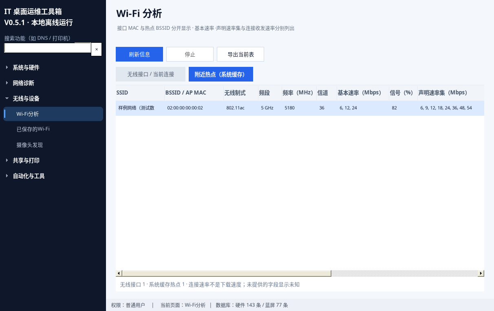
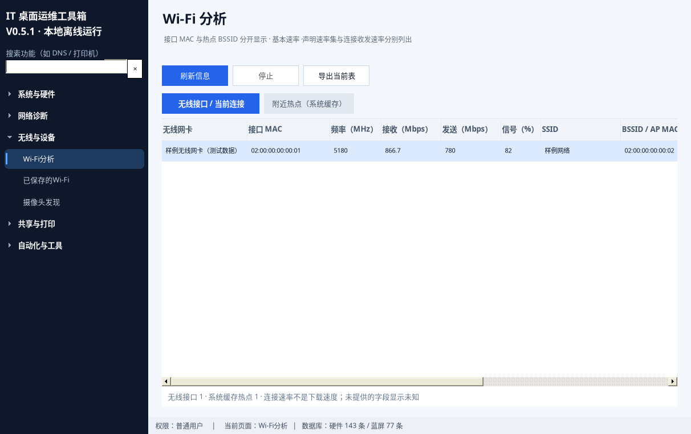

# IT 桌面运维工具箱 V0.5.1

面向 Windows 10 / Windows 11 的 C# WinForms 离线运维工具。V0.5.1 基于 V0.5.0，合并系统与安全菜单、取消常用网络工具的中间入口，并将 Wi-Fi/路由信息整理为表格；保留原有共享、硬件、BAT 自动化及 U 盘防护功能。

## V0.5.1 导航与界面

左侧改为 **5 个可折叠分类、24 个二级入口**，默认只展开一个分类；顶部支持中文名称和关键词搜索，例如 `DNS`、`WiFi`、`打印机`、`MAC`。搜索只筛选入口，不自动执行检查；按回车打开首个匹配入口，清空搜索恢复分类。程序记住上次页面和展开状态。

| 分类 | 功能 |
| --- | --- |
| 系统与硬件 | 系统概览、硬件配置、软件环境、启动项、系统优化、蓝屏/异常关机、系统修复、功能开关、U 盘防护 |
| 网络诊断 | 网络配置/连接测试、持续检测、端口扫描、主机发现、路由与 MAC、DHCP/服务检查 |
| 无线与设备 | Wi-Fi 分析、已保存的 Wi-Fi、ONVIF 摄像头发现 |
| 共享与打印 | 共享文件夹、SMB/NTFS 权限、打印机与服务 |
| 自动化与工具 | BAT 自动化、电脑配置对比、Windows 管理入口、离线数据库 |

下图为 Linux/Mono 实际界面预览，Windows 的字体和窗口装饰可能略有不同：


端口扫描、主机发现直接进入表格与输入区；路由/MAC、Wi-Fi 分析进入后自动读取，不再多点一次“打开”。统一字体、配色、按钮和表格，旧“安全与维护”展开状态会迁移到“系统与硬件”。切换页面会取消该页进行中的读取/检测。

Wi-Fi 表格预览（以下是用于排版测试的样例数据，不是真实无线扫描结果）：





新增工具的使用方法：

- **端口扫描**：默认载入 **125 个常用 TCP 端口**，涵盖文件共享、邮件、远程管理、Web、数据库、打印等，也可手动填写端口或范围。端口列表与常见服务名位于 `src/CommonPorts.cs`；这是常用预设，不包含所有可能的服务端口或 UDP 检测。仅验证 TCP 握手，不发送应用数据；区分开放、拒绝、超时与连接错误。每次最多 1024 个端口，并发 1–32，单次连接超时 100–10000 毫秒。
- **主机发现**：输入 IPv4 或 `/24` 至 `/32` 的 CIDR 网段，例如 `192.168.1.0/24`。只执行 **ICMP Ping**，不再尝试任何 TCP 端口；展示响应状态与往返延迟。最多 256 个地址，无响应不等于离线，关闭 ICMP 的设备可能不响应。
- **路由与 MAC**：进入即只读加载，分别用“网卡/IP/MAC”“路由表”“邻居/ARP”三张表显示。邻居缓存不是完整设备清单，MAC 前缀不能证明整机品牌。
- **DHCP 与网络服务**：显示当前 DHCP 配置、服务器、租约和相关服务；可分别测试 DNS、TCP、HTTP。HTTP 仅发送 HEAD，保持证书校验，不自动带账号密码，不跟随跳转。401/403/405 等也属于服务响应，不代表业务正常。DHCP 页面只读取本机信息，不发送租约申请，不能排除其他 DHCP 服务器或冲突。
- **Wi-Fi 分析**：通过 Windows WLAN API 结构化读取，进入即加载。默认显示附近热点表，可切换到无线接口/当前连接表。分别列出接口 MAC、热点 BSSID、网络类型、无线制式、频段、频率（MHz）、信道、信号（% / dBm）、基本速率、声明速率集和当前收发速率（Mbps）。不依赖 `netsh` 的中英文排版。
  - 附近热点来自系统缓存，刷新读取不保证缓存立即更新；不自动连接或更改无线配置。
  - 基本速率来自热点速率集的基本标记，声明速率集为系统报告的支持速率；二者不等于当前连接速率或实际下载速度，也不保证包含所有现代 PHY 的 MCS 能力。
  - 当前接口收发速率单独列出，不用热点声明速率集冒充实时速率。未提供的数据明确显示“未知”；非 UTF-8 SSID 用十六进制保留原始字节。
  - 部分 Windows 版本要求开启位置服务，读取也可能受服务状态、网卡和组织策略限制。失败会显示原因，不以空表冒充成功。
  - 表格支持排序和横向滚动，CSV 按可见列顺序导出，并处理网络名称导致的公式注入。
- **已保存的 Wi-Fi**：读取本机配置列表；密码必须在单独确认窗口中主动读取。敏感窗口没有导出入口，关闭后清空显示；普通报告不包含密码。
- **摄像头发现**：选择本机局域网 IPv4 网卡，发送 ONVIF WS-Discovery 组播，等待 5 秒。只显示与当前请求匹配的设备声明，不登录、不自动访问声明地址。回复未经认证，不能仅凭声明认定设备身份；跨 VLAN、组播/防火墙限制或不支持发现的设备可能没有结果。

检查均支持停止。扫描过程中只启用停止按钮，避免任务重叠；关闭窗口会先请求停止。结果可导出，未完成的目标不产生检测结论。本版未增加数据包抓包、主动 DHCP 服务器发现、会话压力测试、AI 助手；这些需要另行设计依赖和验证，菜单没有空入口。

## 编译与启动

1. 下载并完整解压源码包，不要只复制 `src` 文件夹。
2. 在 Windows 10/11 上运行 `Build_Only.bat` 编译，或运行 `Build_And_Run.bat` 编译并启动。
3. 程序位于 `build/ITDesktopToolkit.exe`。移动程序时须同时携带 `build/Database`。
4. 普通检查不主动提权；修改打印队列、系统设置或 USB 写保护时按界面提示使用管理员权限。

编译使用 Windows 自带 .NET Framework C# 编译器，脚本会检查编译器是否存在；不需要还原 NuGet 包。运行依赖 Windows PowerShell 5.1 与相应的 Windows 管理接口。

## 沿用 V0.4.6 的功能

- **所选 NTFS U 盘普通用户只读**：在“U 盘检查与防护”中选盘，设置或恢复权限。设置前备份原权限；普通 Windows 用户可读取，管理员仍可写入。只支持 NTFS，不格式化 U 盘；严格跨电脑只读仍需硬件写保护。
- **取得指定文件夹权限**：选择文件夹，递归把 Administrators 设为所有者并授予完全控制。操作结果会列出失败项。
- **BAT 清空回收站**：添加“清空当前用户回收站”动作，永久清理 BAT 实际运行账户在所有驱动器的回收站。此动作不能放入自动重试块。

## 沿用 V0.4.5 的功能

### 电脑配置对比

入口：**自动化与工具 → 电脑配置对比 → 打开电脑配置对比**。

- 在正常电脑和异常电脑上分别点击“采集本机报告”，再“导出本机对比报告”。
- 在同一个窗口导入左、右两份报告，点击“比较两份报告”。
- 对比系统版本/架构、网卡型号与状态、IP/网关/DNS、网络类别、相关服务、SMB 策略及非系统共享目录。
- 差异结果可另存为文本。报告包含电脑名、MAC、内网地址和共享路径，分享前请检查内容。

这是用于排障的报告对比，不会自动修改配置或同步两台电脑，也不提供配置快照还原。

### 打印机专项诊断

入口：**共享与打印 → 打印机与服务 → 打印机专项诊断**。

- 查看默认打印机、脱机状态、驱动、端口和各打印机的排队任务。
- 输入打印机 IP/主机名与端口（默认 `9100`）测试 TCP 连通性，不发送打印数据。
- 输入诊断报告中的准确打印机名称，经确认后取消该打印机的全部排队任务，不清空其他打印机队列。
- 导出诊断结果。取消任务不能撤销；TCP 可连接不等于驱动、耗材或出纸机构正常。

### 网络质量持续检测

入口：**网络诊断 → 网络持续检测**。

- 输入网关、内网服务器或外网目标，以逗号分隔，最多 8 个主机名/IP。
- 设置采样轮数（1–10000）和轮间隔（1–3600 秒），点击开始。
- 每轮并行检测，之后等待轮间隔；记录带时区时间、响应状态和延迟。
- 实时显示最近 20 条，统计无响应/错误比例、最小/平均/最大延迟、相邻成功采样的平均延迟变化。
- 支持停止以及导出完整 CSV。开始新一轮前会提示清空上一轮记录。

检测使用 ICMP。主机禁用 ICMP、名称解析失败、本地权限或网络故障都可能造成检测失败，不能仅凭无响应断定目标断网。DNS 解析耗时也可能影响停止速度。

### 软件清单与环境检查

入口：**系统与硬件 → 软件环境检查**。

- 读取本机/当前用户、32/64 位注册表中的软件名称与版本，展示 .NET Framework v4 Release 和已登记的 VC++ 运行库。
- 不使用可能触发 MSI 修复的 `Win32_Product` 查询。
- 支持导入 UTF-8 软件要求清单、导出模板与检查结果。

清单每行格式为：`软件名称关键词<Tab>最低版本`，最低版本可省略。例如：

```text
Google Chrome	120.0
Microsoft Visual C++
```

关键词匹配不区分大小写。检查结果区分符合、缺失、版本偏低及版本需人工核对。登记清单不能覆盖全部便携软件和其他用户的应用；检查特定运行库架构时，应使用包含年份、x86/x64 的具体名称关键词。

### BAT 条件、分支与失败重试

入口：**自动化与工具 → BAT 自动化 → 添加动作**，原有工作流文件格式继续兼容。

| 新动作 | 参数与行为 |
| --- | --- |
| 如果文件存在 | 参数 1 为完整文件路径；只判断文件，不判断文件夹 |
| 如果网络可达 | 参数 1 为单个 IP/主机名，按 ICMP 响应分支 |
| 如果系统版本 | 参数 1 为 Windows Build 下限，参数 2 为上限（可空）；例如 Win11 初始 Build 为 22000 |
| 否则 / 结束条件 | 对应最近的条件块；否则可省略，每块最多一个 |
| 重试开始 / 重试结束 | 参数 1 为总尝试次数（1–10，默认 3），参数 2 为失败后等待秒数（1–300，默认 2） |
| 检查文件存在 | 文件不存在则报错，适合放在重试块中等待外部程序生成结果 |
| 运行程序并等待 | 参数 1 为路径，参数 2 为启动参数，参数 3 为超时秒（1–86400，默认 60）；非零退出码或超时算失败 |

示例：

```text
如果文件存在       D:\Tools\check.exe
  重试开始         3                 2
    运行程序并等待 D:\Tools\check.exe  /check  60
  重试结束
否则
  运行程序         notepad.exe
结束条件
```

条件/重试最多嵌套 8 层，保存及导出时检查结构是否闭合。失败重试会重新执行整个块，使用者须确认其中操作可重复执行；格式化、删除和清空回收站动作不能放入重试块。程序超时仅尝试结束主进程，不能保证结束其启动的全部子进程。

### U 盘检查与本机防护

入口：**系统与硬件 → U 盘检查与防护**。按本版需求，**不提供资料恢复、自动删除、格式化或自动清理**。

只读检查：

- 从 Windows 识别的可移动存储中选择 U 盘，检查隐藏属性、`autorun.inf`、文档伪装的双扩展名、同名文件夹/程序。
- 读取 `.lnk` 快捷方式指向和参数，提示调用命令/脚本解释器的情况，不执行目标。
- 为不超过 64 MiB 的可疑文件计算 SHA-256；跳过重解析点，最多遍历 50000 个文件/目录、保留 5000 条发现。
- 支持中止、导出报告、按盘符查看 Defender 历史，以及导入其他杀毒软件的文本报告供人工核对。
- **可疑迹象不等于病毒确诊，未发现迹象不等于安全。** Defender 历史可能缺失、受权限限制，也可能对应过去使用同一盘符的其他设备。

本机防护：

- **关闭当前账户自动播放**：设置该账户 `NoDriveTypeAutoRun=255`，影响所有驱动器的自动播放，可能需要重新登录。
- **开启本机 USB 写保护**：管理员设置本机 `StorageDevicePolicies\WriteProtect=1`，通常需要重新插拔，可能影响其他 USB 存储设备。
- 修改前保存原值，可分别还原首次保存的原策略值；还原按钮恢复的是策略设置，不是 U 盘文件。
- 备份按当前运行账户保存在 `%LOCALAPPDATA%\ITDesktopToolkit`，还原时请使用相同账户。

NTFS U 盘权限：选中可移动 U 盘后，可以递归把普通用户设为读取和运行、SYSTEM 设为所有者并保留完全控制、Administrators 保留完全控制。修改前会将原权限备份到当前账户的 `%LOCALAPPDATA%\ITDesktopToolkit`，可通过“恢复所选 U 盘原权限”还原；全部恢复成功后删除备份以便再次设置。只支持 NTFS，不格式化 U 盘；遇到重解析点或无法读取的权限会停止。系统目录 `System Volume Information` 和 `$RECYCLE.BIN` 不参与递归修改。此设置只限制遵守 NTFS 权限的 Windows 普通账户，管理员仍可写入或修改权限。也可选择指定文件夹，递归把 Administrators 设为所有者并授予完全控制；操作结果会显示失败项。

**本机软件写保护仅影响设置过的电脑，不会跟随 U 盘到其他机房电脑，也不阻止手动执行恶意程序。** 组织策略、设备驱动可能影响生效，写入策略成功后仍应重新插拔并验证。需要跨电脑阻止写入时，应选择带物理写保护开关的设备。

## 保留的原有功能

系统与硬件概览、显示器/EDID、网络配置与诊断、蓝屏/异常关机、系统修复、启动项、电源、SMB 共享模式与权限、NTFS 权限、输入法、鼠标键盘自动化及离线故障库。

本版未添加资产管理、维护 U 盘启动器或配置快照功能。

## 测试与验证

当前 Linux 云环境已完成：完整源码 Mono 编译、C# 5 语法编译检查、**125 项检查（原有功能 28 + 网络工具 34 + 工作区/WLAN 数据 26 + 界面导航 37）**，以及原有离线数据库加载/查询冒烟检查。当前只剩原有 `NetworkConfigService.cs` 的 1 条未使用变量警告。

新检查覆盖 CIDR/端口边界、并发上限、取消、TCP 无数据握手与连接关闭、HTTP HEAD/不跟随跳转/取消、命令退出码与错误输出、ONVIF 回复关联及禁用外部实体、菜单搜索/折叠/位置记忆、WLAN 原生结构大小和偏移、频率与速率换算、纯 Ping 调度，以及直接页面/自动读取/真实回环 TCP 扫描/快速切页取消。界面测试通过 Xvfb/Mono 实际创建窗口并生成截图，不等同于 Windows 设备接口验收。当前 Linux ICMP 组件缺失的探测错误会如实记录，不计作 ICMP 连通成功。

Windows 自动验证入口（使用系统 .NET Framework C# 编译器）：

```powershell
powershell -NoProfile -ExecutionPolicy Bypass -File tests\Run-Windows.ps1
```

仓库新增 `.github/workflows/windows-validation.yml`，推送 main 或创建 PR 后在 Windows runner 上编译并运行四套测试、解析 BAT 生成的 PowerShell，再执行条件/重试用例。可在 GitHub Actions 查看实际结果，不能用工作流文件的存在代替运行通过。测试不会修改 USB 策略、打印队列或读取真实 Wi-Fi 密码；导航测试会保存并恢复其使用的导航配置文件。

Linux 检查入口为 `tests/run-mono.sh`；在已有 Mono 开发环境与虚拟显示的云工作区中，设置 `DISPLAY` 后运行 `tests/run-navigation-ui-mono.sh`。这两个脚本使用当前云环境 `/workspace/cloud-setup` 中的工具链。

当前云主机没有 Windows。WLAN 数据解析使用原生格式测试缓冲区验证，UI 截图中的无线数据为测试样例，不能代替真实无线网卡/权限验收。真实无线接口/密码权限、DHCP/路由管理接口、ONVIF 设备、U 盘策略及打印机仍需实机验收，步骤见 [tests/Windows验收.md](tests/Windows验收.md)。

V0.4.6 的回收站动作仅在自动化用例中验证生成与结构，测试不会真正清空回收站；本次合并保留所选 NTFS U 盘只读、原权限恢复与指定文件夹权限取得功能。

## 文件与日志

- 原始离线库：`Database/`；运行时库：`build/Database/`，编译不会覆盖其中已有的用户编辑。
- 导航状态：`%LOCALAPPDATA%\ITDesktopToolkit\navigation-v050.txt`。
- 本地日志与策略原值备份：`%LOCALAPPDATA%\ITDesktopToolkit`。
- 本版文件校验：`SHA256SUMS.txt`。这是 V0.5.1 的完整发布基线，不能与旧版本哈希混用。
- 版本演进与历史记录：[版本更新记录_累计.txt](版本更新记录_累计.txt)。
