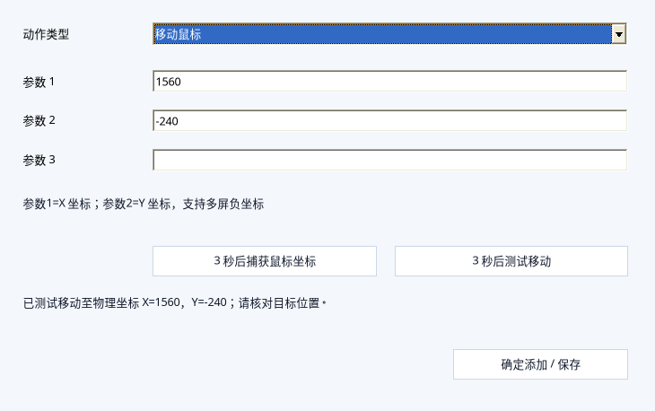

# BAT 自动化独立版 v0.5.14-BAT

从 [IT 桌面运维工具箱 v0.5.14](https://github.com/dayazilaile/WinForms/tree/v0.5.14) 提取的独立 Windows 程序。打开直接进入 BAT 编辑器，运行只需 **BatAutomation.exe**，不依赖原工具箱、数据库目录或额外 DLL。发布使用独立 tag `v0.5.14-BAT`，与工具箱 v0.5.14 同步。

## V0.5.14 可见窗口内完成自删除

针对运行结束时火绒提示“隐藏执行 PowerShell”的反馈，移除**可见模式**末尾自删除所启动的隐藏 PowerShell 清理进程，改由当前 cmd 窗口同步删除正在运行的这个 BAT。运行期间保留黑框，无额外隐藏清理窗口或后台清理任务。

- 保留单个 BAT、自动 UAC、鼠标/键盘、诊断、随机等待、全部动作及“执行到末尾后删除 BAT（成功或失败）”选项，默认仍启用自删除；隐藏运行默认不勾选。
- 删除和退出放在 cmd 预先读取的同一个括号块内，避免文件删除后读取后续命令失败；保留流程原本的退出码。仅删除当前 BAT，文件名按完整路径加引号处理，关闭延迟变量展开。
- 删除失败会在当前窗口输出警告，不伪报已删除；不勾选自删除时仍保留文件并暂停。取消/提权失败不会进入清理。
- **使用方式：不勾选“隐藏运行窗口”，按需要勾选末尾删除，再重新生成 BAT。** 旧 BAT 不会自动更新。手动勾选隐藏模式仍沿用原有隐藏执行实现，安全软件可能继续提示。

截图提示的防护项目为“隐藏执行 PowerShell”，与旧清理代码吻合；这不能证明所有安全检测只针对该行为。云端没有火绒或 Windows 实机，本次不承诺所有机器不再提示。没有关闭防护、添加排除项或采用混淆；工作流主体仍沿用原有编码执行结构。

## 沿用 V0.5.13 的启动代码审查与兼容性改进

保留单个 BAT、自动申请管理员、鼠标/键盘、两种输入引擎、隐藏运行、诊断、末尾自删除、条件/重试和随机等待，原有界面选项与默认勾选不变。

- 自动提权和隐藏运行的启动段从 `-EncodedCommand` 改为可直接审阅的 `-Command`；自动提权仍使用 Windows 标准 `RunAs` 和正常 UAC 同意，不绕过 UAC。已是管理员时继续当前实例，取消或失败时报告并停止，不降权继续执行。
- BAT 路径通过环境变量传递，不拼入 PowerShell 源码；提权直接使用文件关联打开 BAT，减少一层手工拼接的 cmd 参数。
- 没有输入动作且关闭诊断时，不编译无用的输入桥接；只有激活窗口的流程才创建其需要的 WScript.Shell。鼠标动作、物理 DPI 处理、传统中文剪贴板输入和诊断仍保留。
- **这是代码透明度和兼容性改进，不是已验证的火绒拦截修复。** 工作流主体仍沿用原有单 BAT 的 Base64 编码与 ScriptBlock 执行结构，没有宣称完全明文，也没有新增混淆、加密或关闭安全软件的操作。现有自删除和隐藏运行仅按所选选项生成。

对用户提供的 BAT 已做不执行样本的静态审查，并与原版生成器核对；没有发现该样本含下载、额外植入或未知动作。当前云环境没有火绒或可用的病毒库，不能据此证明文件无毒或保证不再拦截。详见 [审查记录](docs/bat-review-v0513.md)。更新生成器后需要重新生成 BAT；旧 BAT 不会自行变化。

## 沿用随机等待

在“添加动作”中选择 **随机等待**，填写：

| 字段 | 示例 |
| --- | --- |
| 最短等待（秒） | 1 |
| 最长等待（秒） | 20 |

每次执行到此动作时，从 1～20 秒（含上下限）中重新抽取一个整数秒数，允许重复；不是在生成 BAT 时固定。重试中的每次执行也重新抽取。可见控制台会显示本次抽到的秒数。

默认 1～20 秒，支持 0～3600 整数秒，上下限相同即固定等待；范围错误会提示。原“等待毫秒”保持不变。启动前延时及其他等待动作另计。新旧流程格式兼容，但包含新动作的流程应使用新版软件。

可打开 [随机等待示例](examples/随机等待示例.workflow.txt) 查看 1～20 秒的设置。该示例只等待，不申请管理员或自删除。

## 沿用独立版框架兼容性修复

继续使用微软 .NET Framework 4.8 引用程序集和最终 EXE 类型归属检查，保留 v0.5.11-BAT 对旧包 Stack<T> 类型加载失败的修复。构建记录见 [BUILD_INFO.json](BUILD_INFO.json)。Windows 验收会直接测试包内 EXE，然后再测试重新编译的 EXE。

## 下载后怎么用

1. 完整解压本包，双击根目录 **BatAutomation.exe**。适用 Windows 10 / Windows 11，建议使用 .NET Framework 4.8 与系统 Windows PowerShell。
2. 点击 **添加动作**，选择类型并填写参数；用 ☰ 拖动排序，或通过 **复制动作 / Ctrl+D** 复用。
3. 点击 **保存流程** 保存可继续编辑的 `.workflow.txt`；**打开流程** 可以读取原工具箱保存的流程。打开流程不会执行其中动作。
4. 选择生成方式、启动延时等选项，再点 **生成 BAT**。生成的 BAT 可独立运行，目标电脑无需安装本程序。

根目录附预编译 EXE；若要从源码重新编译，运行 **Build_And_Run.bat**，编译后启动 `build\BatAutomation.exe`。仅编译可运行 `Build_Only.bat`。移动编译后的程序只需复制 EXE，无需 Database 文件夹。

预编译 EXE 使用 C# 5 和微软 .NET Framework 4.8 引用程序集，云端已检查成品类型引用并完成模拟界面测试。GitHub Actions 会直接运行包内发布 EXE 的测试，再编译并测试 Windows csc 版本；应以实际任务结果为准。当前云端仍不能代替 Windows 实机、输入权限和高 DPI 验收。

## 保留的功能

- 程序启动/等待、等待与激活窗口、鼠标移动/点击/滚轮、按键组合、中文输入。
- 鼠标物理坐标捕获、3 秒后测试移动、键盘录入、已打开/最小化窗口选择。
- 两种 BAT 引擎：新版 SendInput、传统兼容（临时剪贴板粘贴中文）。
- 启动前延时、隐藏运行、管理员 UAC、跨机房环境诊断、执行末尾删除 BAT；选项随工作流保存。
- 文件存在、网络可达和系统 Build 条件，**条件成立时执行 / 条件不成立时执行** 两栏，可添加多个动作、编辑与排序；保存自动补齐否则和结束条件。
- 嵌套条件、失败重试、程序等待与退出码检查；条件/重试块整体复制、拖动和删除，最多嵌套 8 层。
- 原有 DNS、网关、静态 IP/DHCP 等自动化动作和原有文件操作动作，保留参数校验与相应确认。

界面预览使用测试样例，没有执行图片里的程序或网络检测：

## 条件怎么填写

以“如果网络可达”为例：目标填一个真实 IP 或主机名；左栏放有回应时执行的动作，右栏放没回应时执行的动作。无需执行的一边可留空，至少一边应有动作。Ping 无回应也可能是目标禁止 ICMP，并不能直接认定断网。

文件条件填写完整文件路径；系统条件填写 Windows Build 下限和可空的上限，例如 22000–26100。取消编辑不改变原流程，双击主流程的条件可重新进入两栏。

可先通过“打开流程”载入 [条件分支示例](examples/条件分支示例.workflow.txt)：检查 `C:\Windows\explorer.exe` 是否存在，分别等待 1000/500 毫秒；示例不包含删除、格式化或网络修改动作。

## 执行选项与原版保持一致

程序编辑时不执行动作，生成 BAT 后由运行者启动。管理员选项控制 BAT 启动时的 UAC，编辑器本身不自动提权。自删除表示流程到达末尾后尝试删除 BAT，成功或失败都可能走到末尾。

鼠标坐标使用物理像素，缩放/分辨率或显示器布局变更后应重新抓取；输入和窗口激活仍受交互会话、焦点及权限影响。原有网络修改需要管理员，格式化动作不能隐藏运行，清理/格式化动作不能放入自动重试块。独立版沿用原版的这些边界。

## 编译、测试与来源

- 完整源码位于 `src/`，共 12 个文件；自动化引擎、条件编辑、坐标、键盘与窗口选择模块直接沿用 v0.5.14。精确来源及 SHA-256 见 [SOURCE_PROVENANCE.json](SOURCE_PROVENANCE.json)。独立入口、窗口外壳及两个纯辅助方法位于适配文件中。
- Windows 编译：`Build_Only.bat --no-pause`；验收：`powershell -NoProfile -ExecutionPolicy Bypass -File tests\Run-Windows.ps1`。
- 当前云环境通过 **97 项检查（引擎/流程 65 + 独立界面 28 + 成品引用兼容性回归 4）**：工作流兼容、两种 BAT 导出、条件分支、嵌套/重试/深拷贝、模拟鼠标回放，以及在只放 EXE 和测试程序的空目录里打开独立界面。
- 新增范围校验、含上下限、相等边界、运行时脚本、重试内抽取、保存与界面编辑测试；Windows 随机用例拦截等待并验证反复抽取，不实际休眠。
- 测试没有执行用户程序、真实 Ping、输入、鼠标移动或修改系统设置；UI 中的鼠标接口由模拟替代。Windows 测试另外检查生成 PowerShell 的语法与仅访问测试文件的成功/失败重试场景，云端不能代替其执行结果。
- 兼容性回归会检查发布 EXE/构建记录一致性及源码来源，并用 Mono 错误引用生成反例，确认可以阻止本次同类错误。开发者跨编译入口为 `tools/build_framework.py`，先安装 `tools/requirements-build.txt`，使用 `--references` 指定微软引用程序集目录；缺失时可用 `--download-references` 下载固定哈希的官方包，引用 DLL 不随运行 EXE 分发。`tests/test_framework_metadata.py` 检查实际发布文件。
- Windows 系统接口与缩放验收见 [tests/Windows验收.md](tests/Windows验收.md)。当前 Linux Mono 检查入口为 `tests/run-mono.sh`，使用本云环境 `/workspace/cloud-setup` 的工具链；有虚拟显示时设置 `DISPLAY` 可同时运行 UI 检查。
- `SHA256SUMS.txt` 对应本 tag 包内文件（不含清单自身）；Windows CI 产出的二进制会重新编译，其压缩包内有独立校验清单，不应与本 tag 预编译 EXE 的哈希混用。
