# IT 桌面运维工具箱 V0.5.22

面向 Windows 7 SP1、Windows 10/11 的 C# WinForms 离线运维工具。V0.5.22 修正编译前过严的运行库门槛和检测提示：最低 .NET Framework 4.5，建议 4.8；保留便携日志与自动化功能。

## V0.5.22 修正编译前运行库检查

用户截图中的信息来自编译前的环境检查，C# 编译器尚未运行。旧版硬性要求 .NET Framework 4.8，提示也没有显示实际检测到的值；仅凭该截图不能区分确实未安装、版本较低和注册表查询未读取成功。

本版做了三项修正：

1. **最低要求改为 .NET Framework 4.5，4.8 保留为推荐。** 使用微软官方 4.5 引用程序集重新编译全部源码，并替换日志中的 AsyncLocal 依赖，改用传递字符串操作编号的逻辑调用上下文；子任务日志关联继续验证。不是只删检查、留下较新 API 依赖。
2. **构建与启动检测一致。** 新增 Check_Runtime.bat，分别读 64 位、32 位和原生注册表视图，校验 DWORD，取最高有效 Release，并正确处理十六进制值。批处理使用 CALL 避免 FOR /F 对带引号程序路径的解析问题。提示显示实际 Release、读取视图和版本标签，区分“低于最低值”与“未读取到”。程序启动也检查两种视图，不再只看当前进程的一种。
3. **提供只读诊断。** 双击 Diagnose_Runtime.bat 查看系统版本、运行库检测值和编译器位置；不安装组件、不改注册表/安全策略、不保存诊断日志。

### 这类提示怎么处理

先完整解压 [v0.5.22](https://github.com/dayazilaile/WinForms/archive/refs/tags/v0.5.22.zip)，再运行 Build_And_Run.bat。需要保留新加入的 Check_Runtime.bat。

- 已有 .NET 4.5、4.5.1/2、4.6.x、4.7.x、4.8/4.8.1 的电脑，不应再因“必须 4.8”而被挡住。
- 若明确低于 4.5，或核对后确实没有安装，需要安装微软官方运行库；本软件不会自动下载或安装。支持时建议 [.NET Framework 4.8 官方下载](https://dotnet.microsoft.com/zh-cn/download/dotnet-framework/net48)。Win7 仍需要 SP1。
- 若显示“未读取到”，请运行 Diagnose_Runtime.bat，把完整输出交给开发者；不要直接把读取失败认定成运行库不存在。安全产品拦截注册表读取也可能导致这种情况。
- PowerShell 是另一项前提：生成的 BAT 仍要求 Windows PowerShell 5.1，微软的该组件自身要求至少 .NET 4.5.2。程序运行库检查放宽，不代表旧系统自动拥有 PowerShell 5.1 或新版网络模块。

云端使用微软 .NET 4.5 引用程序集完整编译并通过 **521 项工具箱检查**，独立版 **133 项**；另编译核对 4.8 引用配置。已添加 7 个 Windows 专用批处理检测场景（空格路径、十六进制、32 位回退、最高值、原生回退、版本不足、读取不到/类型不符），不改真实注册表，接入 Windows 测试入口。云端仅解析其 PowerShell 语法，没有 Windows cmd.exe，因此不声称这些批处理场景已在云端执行。真实旧版 Windows/.NET 仍需实机验收。

同步提取 [v0.5.22-BAT 独立包](https://github.com/dayazilaile/WinForms/archive/refs/tags/v0.5.22-BAT.zip)。Server 仍保持 v0.5.20-Server 冻结，旧版本要求不回写到定版包。

## V0.5.21 可定位电脑的操作日志

日志继续保存在软件/脚本自己的目录，升级为带中文列名的 **UTF-8 TSV 表格**，可以用记事本查看或导入表格软件筛选。

| 内容 | 记录字段与用途 |
| --- | --- |
| 时间 | 日期、时分秒、毫秒、时区偏移；结束记录另有耗时。使用本机时钟，不是可信时间戳。 |
| 主机 | 当前主机名、硬件 UUID、BIOS 序列号、设备标识及其来源，联合核对同传后主机名重复的电脑。 |
| 网卡 | 每张有效网卡分别记录名称、类型、系统接口 ID、MAC、连接状态、IPv4/IPv6、IPv4 掩码、DHCP、网关和 DNS。不随意选一个 MAC 当作整机身份。 |
| 执行环境 | 运行账户、管理员/普通用户权限、系统版本/架构、软件版本。 |
| 关联编号 | 会话 ID 标记一次程序运行；操作 ID 关联同一操作的开始/结束/过程；上级操作 ID 关联页面任务与其子命令。 |
| 操作 | 页面/动作名称、阶段、结果、必要的目标配置与失败原因。命令返回不自动视为业务成功，卸载器启动也不等于卸载完成。 |

### 保存位置

- 工具箱统一操作记录：`EXE目录/Logs/operations-v1.tsv`。页面任务、系统命令、手动改 IP/MAC、打开管理工具、保存标准、生成清理脚本、启动卸载等使用这套身份信息；诊断记录也进入同一表。
- 手动改 IP 的修改前备份：仍在 `Data/Computers/电脑名`，补充主机名、UUID/序列号、设备标识、网卡 MAC 和时间；统一操作表的开始/结束分别读取当时的网卡配置。电源、启动项、RDP 的原修改记录也补充身份抬头，不改变其恢复参数。
- 含网络配置动作的 BAT：`BAT目录/Logs/network-operations-v1.tsv`。记录修改前、修改后、目标参数、随机 IP 的尝试/占用/换号、异常与恢复请求。原 netsh 备份仍在旁边 Logs，身份说明使用 `#` 注释，不把说明当成 netsh 命令。
- 纯鼠标键盘/等待 BAT 不新增文件日志；标准软件批量清理继续仅完成弹窗、不新增学生机执行日志。工具箱上“生成清理 BAT”的记录仅代表生成，不代表已在学生机运行。

目录不可写不回退 AppData 或 TEMP。手动 IP/MAC 在开始记录失败时拒绝修改；网络 BAT 在无法写入日志时停止后续流程，避免自动重试反复改址。结束记录失败可能发生在设置已经改变之后，应查看界面/当前配置，不能据此认为没有修改；失败日志也不等于恢复失败。普通诊断记录写入失败会保留日志警告。

### 标识的可靠性与隐私

设备标识优先由有效硬件 UUID 生成；没有时使用有效 BIOS 序列号，仍无数据才按 MAC 集合生成。都没有时明确标为“仅本次会话”。UUID/序列号在工具箱后台读取，首次记录尚未读到时可能暂用 MAC，随后补齐；可用会话 ID、操作 ID 和 MAC 联合串联这些行。MAC 顺序变化不改变同一集合的标识。

**这些是核对线索，不是不可伪造的身份证明。** OEM 固件可能缺失或重复，虚拟机克隆、换网卡、随机 MAC、改 MAC 也会影响识别；现场应结合主机名、UUID/序列号、多张 MAC 和机房已保存的名单判断。读取不到写“未读取”，不以全零或占位值冒充真实标识；不承诺所有电脑都提供有效 UUID。

不写入密码、Wi-Fi 密码、自动化输入的文字、完整 PowerShell 指令或命令输出。必要诊断信息会过滤常见密码字段；换行/制表符转义，类似公式的字段按文本写入，避免伪造日志行或表格公式。日志本身包含设备和账户信息，请随 U 盘妥善保管；删除目录只删除工具箱自己的便携数据，不删除 Windows/卸载器/杀软记录。

原有日志不自动重写或删除。**Server 仍保持 v0.5.20-Server 定版，本次没有更新它。** 常用版 v0.5.21 同步重新提取 [v0.5.21-BAT 独立包](https://github.com/dayazilaile/WinForms/archive/refs/tags/v0.5.21-BAT.zip)。本次云端工具箱 517 项、独立版 133 项检查通过，并运行网络日志/恢复模拟；不代表 Windows、硬件接口或杀软实机验收。原有报毒问题记录继续保留。

## V0.5.20 安全复核、旧系统兼容与 U 盘便携存储

**用户尚未测试 v0.5.19。本次不能把 v0.5.19 或本版写成“报毒已解决”。** 当前问题记录是：加入机房软件标准清单/对照卸载功能后，双击工具箱被火绒/360 拦截；360 提示风险类型为“创建进程”。目前没有取得这次被拦截的 EXE 与完整检测详情，不能仅凭风险名称确定病毒、误报或准确触发规则。

- 复核启动路径：入口 → 环境检查 → 主窗体 → 系统概览/数据库。清单对照不执行卸载，清理模板仅明确生成时读取；启动不导出或执行清理 BAT、不提权、不调用工具箱子进程。新增启动回归监视全部托管进程启动入口。WMI 可能由 Windows 服务启动自己的提供程序，不能据此保证系统没有创建其他进程。
- 系统命令固定到 Windows 安装目录，不在 U 盘当前目录/PATH 搜索同名程序。工具箱管理用 PowerShell 改为可直接审阅的 `-Command`，移除 `-EncodedCommand`；不加混淆、隐藏启动参数、执行策略绕过或防护排除。命令过长时明确拒绝。**正常管理功能仍需创建进程，不能承诺 360 不提示。**
- 单项卸载与批量清理统一原则：普通厂商 EXE 或有效 MSI 产品代码才能代执行；通用脚本/加载器、缺少产品代码的 MSI、直接 UNC 卸载程序转交 Windows 程序管理核对，不强制执行。不改变批量清理的确认/自动模式与原有保护项。
- 日常版面向 Win7 SP1、Win10、Win11；另外提供一次性冻结的 **[v0.5.20-Server 定版包](https://github.com/dayazilaile/WinForms/archive/refs/tags/v0.5.20-Server.zip)**。Server 包后续不随日常版本更新。它是兼容实现快照，**不是各版 Server 实机认证**。

### 便携目录

| 内容 | 自动保存位置 |
| --- | --- |
| 程序运行日志 | EXE 目录下 `Logs/toolkit.log`，行内标明电脑名 |
| 软件标准、机房/MAC 清单、界面偏好 | EXE 目录下 `Data` |
| 手动改 IP、共享权限、启动项、电源等恢复备份/修改记录 | `Data/Computers/电脑名` |
| 生成 BAT 中原有静态网络动作的备份 | BAT 所在目录下 `Logs` |
| 随机 IPv4 动作 / 软件批量清理 | 沿用控制台或完成弹窗，不新增文件日志 |

路径按实际程序位置决定，不依赖启动时的工作目录。目录不可写时提示失败或日志警告，不回退到 AppData、桌面或 TEMP；保存报告的默认位置也改为软件目录，用户仍可在保存窗口另选位置。U 盘请保持可写，删除前保留需要的恢复备份和机房清单。按电脑名分开备份，机房电脑应使用不同计算机名。

不自动读取、迁移或删除旧版 `%LOCALAPPDATA%/ITDesktopToolkit`，已有标准/机房文件可通过导入或手工复制转入本包 `Data`。删除软件目录会删除这套便携数据，但不会撤销已修改的系统设置，也不能删除 Windows、360/火绒或厂商卸载器自行产生的日志。

### 系统范围与差异

V0.5.20 发布时所有包要求 **.NET Framework 4.8 或更新的 4.x**（常用版当前要求见上方 V0.5.22，Server 定版仍按旧要求），编译脚本与启动入口会检查；涉及 PowerShell 的功能建议统一安装 **Windows PowerShell 5.1**，生成 BAT 在解析载荷前强制核对 5.1。组件只作检测，不自动下载、安装或改安全策略。

| 系统 | 本次实现与边界 |
| --- | --- |
| Win7 SP1，32/64 位 | 硬件内存读取兼容旧字段；WMI 网络配置报告；IPv4 路由/ARP 缓存兼容读取；控制面板替代新版设置 URI。IPv6 网卡地址仍显示，兼容路由表不包含 IPv6 路由/邻居。 |
| Win10 / Win11 | 保留现有功能，使用新版系统网络接口；仍需实机复测。 |
| Server 2008 R2 SP1，带桌面 | 按 Win7 兼容路径；必须具备上述运行库。 |
| Server 2012 / 2012 R2，带桌面 | 使用新版网络接口；需要 .NET 4.8、PowerShell 5.1 与对应系统角色/模块。 |
| Server 2016 / 2019 / 2022 / 2025，带桌面 | 同一兼容快照；无线、打印、组策略等取决于已安装角色与系统策略，缺失时明确提示。 |
| Server Core / Nano、2008 非 R2、XP/Vista | 不列入此 WinForms GUI 的支持范围，不宣称所有 Server 版本都能运行。 |

**Win7/2008 R2 没有 NetTCPIP/DnsClient 新版命令集，即使升级 PowerShell 也不会补齐系统模块。** 生成 BAT 中设置 DNS/静态或随机 IPv4/默认网关/DHCP 等高级网络动作会在任何网络备份或修改前拒绝执行，避免半完成。可使用工具箱手动 IPv4 页面（netsh/WMI）。高级共享、防火墙及存储命令也依赖所在系统提供对应模块，不承诺把新版系统功能移植到旧系统。WOL、Ping、软件清单、标准对照及基础鼠标键盘/等待自动化保留。

验证：云端 **501 项工具箱检查**（含真实窗口创建与纯模拟系统调用）、独立版 131 项检查，另运行 PowerShell 7 的旧系统配置、便携网络备份、冲突/恢复与原清理/等待用例。编译使用微软 .NET Framework 引用程序集。云端没有真实 Windows、360/火绒或有效病毒库扫描结果，不能据此保证无毒、无误报或所有系统均已验证。细节见 [审查记录](docs/security-review-v0520.md) 与 [Windows 验收](tests/Windows验收.md)。

## V0.5.19 随机设置 IPv4

入口：**BAT 自动化 → 添加动作 → 随机设置 IPv4**。仍导出一个 BAT；工具箱与 [v0.5.19-BAT 独立版](https://github.com/dayazilaile/WinForms/archive/refs/tags/v0.5.19-BAT.zip) 使用相同自动化代码。

| 填写项 | 示例 | 说明 |
| --- | --- | --- |
| 网卡名称 | 自动有线 | 也支持自动无线，或准确网卡名（如以太网）；自动模式必须唯一匹配已连接的物理网卡。 |
| 地址段 / CIDR | 192.168.1.0/24 | 可简写 192.168.1；不写掩码默认为 24，支持 8–30 位。固定输入地址的前三段，只随机末段。 |
| IPv4 网关 | 192.168.1.254 | 必须是同一子网内的有效主机地址，自动从候选中排除。 |
| 成功后 | 继续流程 / 结束脚本 | 前者执行后面的动作；后者立即结束整个流程，包括当前嵌套分支/重试。两者都走原来的 BAT 收尾及自删除设置。 |


末段只从 **1–99、101–253** 随机抽取；不使用 0、100、254、255，也排除实际子网的网络/广播地址、网关和本机其他网卡地址。比如 `172.26.8.0/20` 搭配 `172.26.0.1`，只在 `172.26.8.*` 中抽取；`192.168.1.128/25` 会进一步排除不属于该子网的候选。

每次随机选择尚未尝试的地址，先查 ARP/邻居占用证据，再设置静态 IPv4 并观察 Windows 重复地址检测 **10 秒**。发现占用或 Duplicate 就换号；完整观察后需成为 Preferred，且确认掩码、静态模式和网关才算成功。10 秒是一次设置后的观察时间，查询、设置与冲突重试另计。**Ping 无回应不代表地址空闲；关机、未响应设备或网络限制仍可能造成漏检，不能保证绝无冲突。**

本动作需要管理员权限，沿用现有正常 UAC 选项；不增加隐藏进程或防护排除。修改本机地址可能中断正在进行的远程连接。开始前检查连接、原配置和 DAD 状态；网卡未连接、关闭重复地址检测、多 IPv4 或多条默认路由时停止，不猜测应覆盖哪一项。候选只尝试一轮，耗尽或配置异常即停止后续流程，并尝试恢复原 DHCP 模式或原单个静态地址/网关；恢复失败明确提示。恢复 DHCP 不保证立即取得原租约。脚本不写 DNS 设置，不为这个动作留下配置备份/报告文件。

先更新工具箱再重新提取独立包，10 个共用源码文件逐字节相同。云端通过工具箱 **474 项**、独立版 **131 项**检查；另实际执行 PowerShell 模拟用例，核验占用跳过、Duplicate 换号、失败恢复及两种成功方式。网络系统调用、时间、管理员状态均由测试替代，未修改云端网卡；未完成真实 Windows 网络与火绒实机验收，不能保证不提示。

## V0.5.18 主程序告警复核与 BAT 共用封装

针对 v0.5.17 主程序被火绒以 `HEUR:Trojan/MSIL.AutoRun` 拦截的反馈，检查标签源码、编译入口及云端重建产物。没有发现新增启动即清理、开机启动登记或后台下载；但用户实际被检测的 Windows EXE 尚未取得，**不能因此直接认定误报，也不能承诺本版一定不再拦截**。证据与限制见 [审查记录](docs/security-review-v0518.md)。

- **复用已用过的 BAT 写法**：清理脚本和 BAT 自动化直接共用同一个封装/可见启动/载荷写入模块；没有分别维护两套。原有自动化 96 组配置的完整 BAT 与旧版逐字节一致，保留两分钟超时、提权、输入、隐藏、自删除等设置。
- **清理代码公开为明文模板**：`Scripts/SoftwareCleanup.ps1` 不再作为长字符串直接嵌入主 EXE；生成时做 SHA-256 完整性校验，异常时停止生成。模板不在程序启动时执行，清理业务与两种模式保持，只统一自身路径变量。
- **完整包部署**：完整解压后运行 Build_And_Run.bat，编译会把模板复制到 `build/Scripts/SoftwareCleanup.ps1`。移动工具箱时保留整个 build 文件夹（包括 Database 与 Scripts）。模板仅生成电脑需要，学生机仍只需生成的单个 BAT。
- 按约定先更新工具箱，再重新提取 **[v0.5.18-BAT 独立包](https://github.com/dayazilaile/WinForms/archive/refs/tags/v0.5.18-BAT.zip)**。独立版只包含自动化模块，无需清理模板或 Database，继续保留微软引用程序集与成品类型归属验证。

保持火绒开启复测。本版没有关闭防护、添加排除项或采用混淆；源码和功能核对不等于火绒实测。旧 BAT 不会自行更新，需要重新生成才会使用共用封装。

## 沿用 V0.5.17 的完整标准清单生成卸载脚本

同传机房可先把标准机上应保留的**全部已登记软件**保存为标准。新增入口：**系统与硬件 → 软件环境检查 → 标准清单 → 导出批量卸载脚本**。

生成时选择一种方式：

| 模式 | 在学生机上的行为 |
| --- | --- |
| 确认后批量卸载 | 先列出标准外的软件，确认一次后开始；有登记静默命令的优先使用，否则打开该软件的卸载向导。取消不执行卸载。 |
| 自动执行 | 不弹开始确认，使用登记的静默卸载方式；MSI 使用明确产品代码及 `/qn /norestart`。没有可核对静默方式的项目跳过，不猜测 `/S` 等参数。 |

生成的是**一个 BAT**，内置当前标准的名称/发布者规则，可通过现有机房下发工具送到学生机运行。目标电脑无需安装工具箱或另带标准文件；脚本重新读取学生机本机及运行用户的 32/64 位登记，对照标准保留已有项目，再找本机卸载程序，不能拿教师机的卸载路径直接执行。更新标准后需要重新导出脚本。

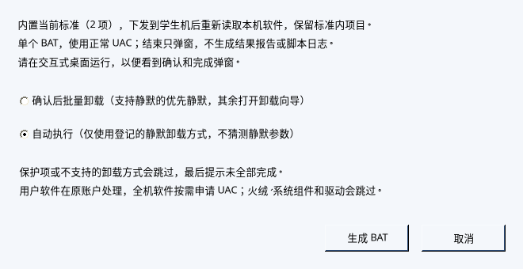

**只用弹窗反馈，不生成结果报告或脚本日志。** 最后提示已完成、未全部完成、取消或需要重启。当前用户软件在原运行账户处理，全机软件按需申请正常 UAC；管理员阶段不处理另一个管理员账户的用户应用，也不重复弹完成提示。请在交互式桌面运行，后台服务/Session 0 不保证能看到弹窗；其他未登录用户的软件不属于本次扫描范围。

每次启动卸载前重新核对登记，重复卸载命令只处理一次；退出后重新读取软件清单，登记仍在不能只凭返回码 0 宣称已移除。清理依据是登记清单，不保证所有软件残留文件也被清除。单个卸载器超过十分钟未结束时停止本轮，不强杀安装器；需要重启时提示重启后再核对，不主动重启电脑。

系统组件/更新、登记为不可卸载项以及常见安全、教学管理、驱动和基础运行组件会跳过；火绒等防护不会因为标准漏项而被批量删除。通用脚本执行器、无法核对的路径/产品代码、不完整读取或登记变化也不会强制卸载。标准机与学生机一致时这些组件应已在完整标准中。未能处理的项目会反映在最后的未完成提示中。

脚本不主动写日志或报告，也不改日志策略；Windows 和各软件卸载器自身的记录/行为不受这个选项控制。单 BAT 沿用 Unicode Base64 内嵌脚本以兼容中文，没有使用隐藏启动、EncodedCommand 或执行策略绕过；不能据此保证火绒不提示。云端运行用例使用模拟登记、确认、进程和弹窗，没有执行真实卸载或 UAC；Windows 实机与火绒兼容仍需验收。

## 沿用 V0.5.16 的标准软件清单与多出软件卸载

入口：**系统与硬件 → 软件环境检查**。

1. 在配置正确的电脑上点击 **标准清单 → 从本机建立 / 更新标准**。打开勾选表格，保留应该安装的软件；可以修改完整名称、发布者，也能添加或删除行。草稿来自本机完整登记清单，不受搜索或显示范围影响。
2. 点击 **保存标准清单**。保存前可取消，取消不会改变当前标准；空清单、非法内容或保存失败会留在编辑窗口提示，不覆盖原清单。
3. 保存后自动切到 **多出软件**，也能切换 **全部软件 / 缺少软件**。列表铺满结果区，支持搜索、列排序和 CSV 导出。多出/缺少的总数按完整清单计算，不受搜索过滤影响。
4. 对多出来的软件 **右键 → 卸载所选软件 → 确认**，进入该软件登记的卸载向导。卸载完成后点击 **刷新软件清单** 重新核对；启动卸载向导不会把该行直接当作已卸载删除。
5. 点击 **标准清单 → 导出标准清单**，把生成的 TXT 复制到其他电脑，再通过 **导入标准清单** 对照。当前标准自动保存在本机当前用户，下次进入或重启后可继续使用；不同机房可分别导出和导入各自的文件。

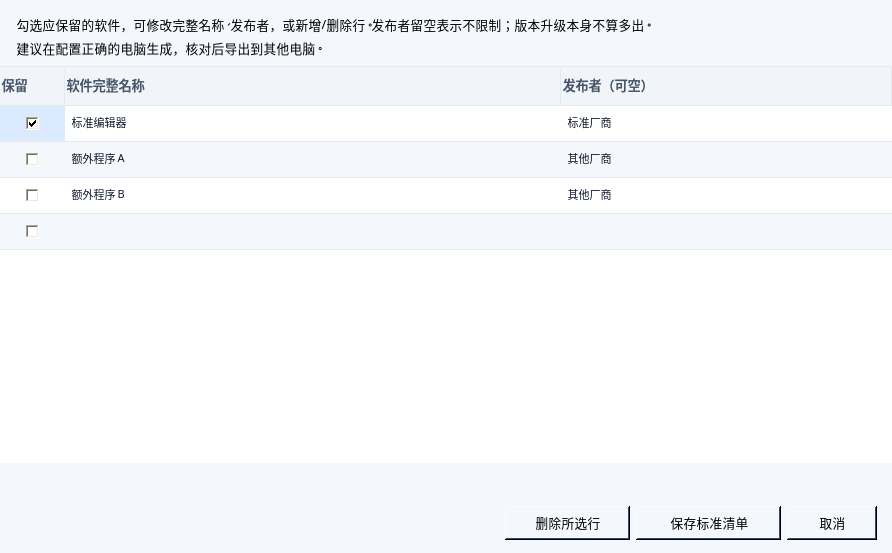

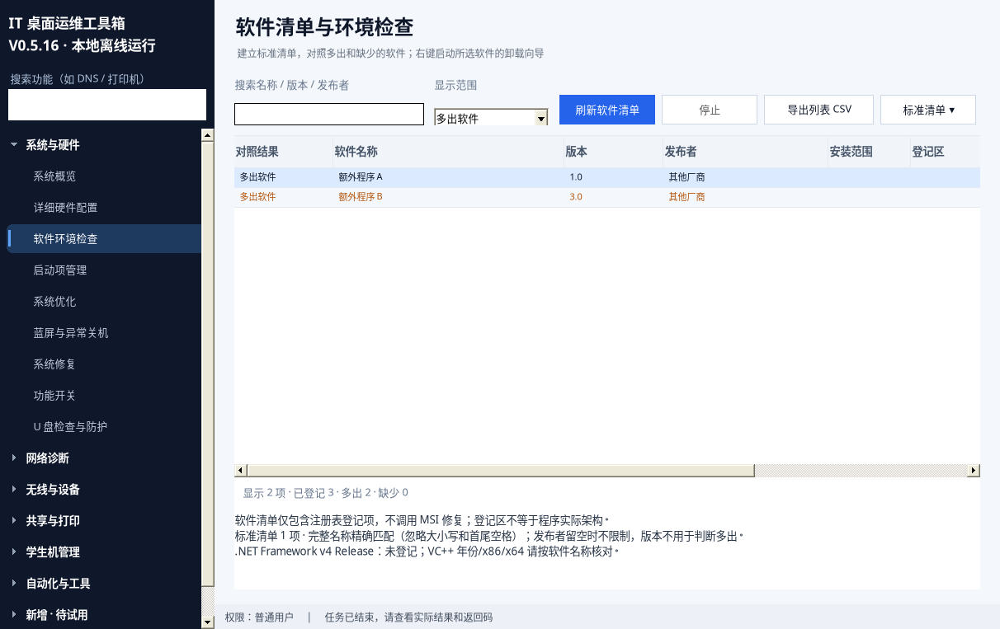

对照规则：**软件完整名称精确匹配**，忽略大小写和首尾空格。发布者填写时一并精确匹配，留空表示不限制发布者；不会仅凭关键词相似就当成同一个软件。版本列变化本身不算多出；如果软件完整名称本身包含版本号且升级后改名，需要核对并更新标准。登记区/安装范围不同的实际项目仍分别显示，右键卸载保持对应的原始登记身份。

“缺少软件”仅为标准条目，没有可卸载的本机记录，不能发起卸载。登记为不可卸载或没有有效卸载程序的项目不提供强制删除，可在 Windows 设置核对。没有有效标准时，不会把全部已安装软件标成多出；标准读取失败显示原因。部分注册表读取失败时，“缺少”显示为“未找到 / 待核对”，避免把读取不到当成确定未安装。

标准清单只含名称和发布者，不带卸载命令；原来的关键词/最低版本检查保留在 **标准清单 → 版本检查**，两类文件不能混用。本页仍只涵盖本机与当前用户的注册表登记软件，不涵盖所有便携软件、商店应用或其他用户软件。截图数据为测试注入，云端测试没有执行真实卸载。

## 沿用 V0.5.15 的两分钟等待与判断超时收尾

- **等待窗口**：参数 1 为窗口标题关键词，参数 2 为超时秒数，默认 **120 秒**，可填 1～120。超过时限仍未出现窗口，停止后续动作，返回失败并进入 BAT 收尾，不再额外等待 15 秒。
- **条件判断**：文件存在、网络可达、系统版本的单次判断最多等 120 秒；判断超时、报错或结果不明确时终止流程，不进入任一分支，也不重复执行外层重试。明确为“是/否”时继续走原来的成立/否则分支；Ping 无回应仍可作为否，不表示一定断网。
- **自动删除**：保留“执行到末尾后删除 BAT（成功或失败）”选项。勾选时，超时/异常返回后自动尝试清理；可见模式继续在当前黑框内完成，不新增隐藏清理进程。未勾选时保留文件并暂停；文件锁、权限或防护拦截仍可能导致删除失败并显示警告。
- 该时限只约束等待窗口及条件求值，不限制整个流程总时长；固定等待、随机等待和显式程序等待保持各自设置。判断通过进程内 PowerShell 实例限时执行，不另开判断进程；超时请求异步取消，不等待可能阻塞的同步停止/释放。

**旧流程请注意**：参数 2 留空时新版默认 120 秒；若原来明确填了 `15`，请改为 `120`。大于 120 的旧设置需先调整到 1～120 才能生成。更新程序后重新生成 BAT，旧 BAT 不会自行更新。保持不勾选隐藏、勾选末尾删除即可沿用上一版的可见清理方式。

已统一异常退出并回归检查，避免错误被吞掉后误报成功或继续动作；Windows 原生 cmd/UAC/输入与火绒兼容性仍需实机验收。新增脚本运行用例在 Linux PowerShell 7.4.13 实际执行，超时用例缩短到 1 秒验证机制，没有宣称在 Windows 上完成两分钟实测。

## 沿用 V0.5.14 的可见窗口内完成自删除

针对运行结束时火绒提示“隐藏执行 PowerShell”的反馈，移除**可见模式**末尾自删除所启动的隐藏 PowerShell 清理进程，改由当前 cmd 窗口同步删除正在运行的这个 BAT。运行期间保留黑框，无额外隐藏清理窗口或后台清理任务。

- 保留单个 BAT、自动 UAC、鼠标/键盘、诊断、随机等待、全部动作及“执行到末尾后删除 BAT（成功或失败）”选项，默认仍启用自删除；隐藏运行默认不勾选。
- 删除和退出放在 cmd 预先读取的同一个括号块内，避免文件删除后读取后续命令失败；保留流程原本的退出码。仅删除当前 BAT，文件名按完整路径加引号处理，关闭延迟变量展开。
- 删除失败会在当前窗口输出警告，不伪报已删除；不勾选自删除时仍保留文件并暂停。取消/提权失败不会进入清理。
- **使用方式：不勾选“隐藏运行窗口”，按需要勾选末尾删除，再重新生成 BAT。** 旧 BAT 不会自动更新。手动勾选隐藏模式仍沿用原有隐藏执行实现，安全软件可能继续提示。

截图提示的防护项目为“隐藏执行 PowerShell”，与旧清理代码吻合；这不能证明所有安全检测只针对该行为。云端没有火绒或 Windows 实机，本次不承诺所有机器不再提示。没有关闭防护、添加排除项或采用混淆；工作流主体仍沿用原有编码执行结构。

## 沿用 V0.5.13 的启动代码审查与兼容性改进

保留单个 BAT、自动申请管理员、鼠标/键盘、两种输入引擎、隐藏运行、诊断、末尾自删除、条件/重试和随机等待，原有界面选项与默认勾选不变。

- 自动提权和隐藏运行的启动段从 `-EncodedCommand` 改为可直接审阅的 `-Command`；自动提权仍使用 Windows 标准 `RunAs` 和正常 UAC 同意，不绕过 UAC。已是管理员时继续当前实例，取消或失败时报告并停止，不降权继续执行。
- BAT 路径通过环境变量传递，不拼入 PowerShell 源码；提权直接使用文件关联打开 BAT，减少一层手工拼接的 cmd 参数。
- 没有输入动作且关闭诊断时，不编译无用的输入桥接；只有激活窗口的流程才创建其需要的 WScript.Shell。鼠标动作、物理 DPI 处理、传统中文剪贴板输入和诊断仍保留。
- **这是代码透明度和兼容性改进，不是已验证的火绒拦截修复。** 工作流主体仍沿用原有单 BAT 的 Base64 编码与 ScriptBlock 执行结构，没有宣称完全明文，也没有新增混淆、加密或关闭安全软件的操作。现有自删除和隐藏运行仅按所选选项生成。

对用户提供的 BAT 已做不执行样本的静态审查，并与原版生成器核对；没有发现该样本含下载、额外植入或未知动作。当前云环境没有火绒或可用的病毒库，不能据此证明文件无毒或保证不再拦截。详见 [审查记录](docs/bat-review-v0513.md)。更新生成器后需要重新生成 BAT；旧 BAT 不会自行变化。

## 沿用 V0.5.12 的随机等待

入口：**BAT 自动化 → 添加动作 → 随机等待**。

- **最短等待（秒）**填 `1`，**最长等待（秒）**填 `20`，执行时就从 1～20 秒（含 1 和 20）中随机抽取一个整数秒数。
- 每次运行到该动作时重新抽取，包含重试块中的每次重试；允许重复，不保证连续两次不同。生成 BAT 时不会预先固定等待值。
- 随机范围只影响该动作，启动前延时和其他等待动作会另外累加。默认范围 1～20 秒，支持 0～3600 的整数秒；上下限相同则固定等待该秒数。空值、小数、超范围或最短大于最长时留窗提示；原“等待毫秒”保持固定等待及原有单位。
- 可放在普通流程、条件的任一分支或重试中，支持编辑、复制和保存范围。普通可见控制台会显示本次抽到的秒数；本功能不额外保存运行日志。
- 两种 BAT 引擎行为一致，旧流程继续可读；包含新动作的流程请用新版本打开和生成。


按约定先更新工具箱，再重新提取 **[v0.5.18-BAT 独立包](https://github.com/dayazilaile/WinForms/archive/refs/tags/v0.5.18-BAT.zip)**。独立包继续使用微软 .NET Framework 引用程序集及成品类型引用检查，保留上一版 Stack<T> 兼容性修复。

## 沿用 V0.5.10 的条件双分支编辑

入口：**自动化与工具 → BAT 自动化 → 添加动作**。选择“如果网络可达”“如果文件存在”或“如果系统版本”，窗口直接显示两个分支栏：

1. 填写条件本身：网络填写 **目标 IP / 主机名**，文件填写 **文件完整路径**，系统填写 **Build 下限 / 上限**。不需要的参数框会隐藏，网络条件只填一个目标。
2. 在 **条件成立时执行** 栏点击“添加动作”，选择要执行的动作并填写其参数；可以继续添加多个动作，按顺序执行。
3. 在 **条件不成立时执行** 栏设置另一组动作。无需执行的一边可留空，至少一边应有动作；每栏支持编辑、删除、上移、下移，也可添加嵌套条件。
4. 点击“确定添加 / 保存”，自动补齐 `否则` 和 `结束条件`，无需自己逐行拼结构。主流程继续显示展开的动作，双击条件标题即可重新进入两栏编辑。

例如：条件选择“如果网络可达”，目标填 `192.168.1.1`（换成实际网关或电脑 IP），左栏放有回应时的动作，右栏放无回应时的动作。Ping 没回应也可能是目标禁止 ICMP，不能据此认定断网。

编辑在草稿中进行，取消或关闭不改原流程；条件为空、版本范围错误、分支不闭合等会留在窗口提示。新条件保存时检查动作参数与嵌套结构，不执行其中的网络或系统动作。复制、删除、拖动条件/重试块会包含完整块，避免分离开始、否则和结束标记。

继续使用原工作流格式，旧条件块可重建为两栏，原有嵌套和省略否则的结构保留；旧重试块保留，块内动作可在主流程编辑。原有重试和两种 BAT 执行引擎沿用，最多嵌套 8 层。

以下为 Linux/Mono 真实窗口，目标为文档测试地址，两个分支使用等待动作；测试没有执行 Ping 或生成流程中的实际动作：

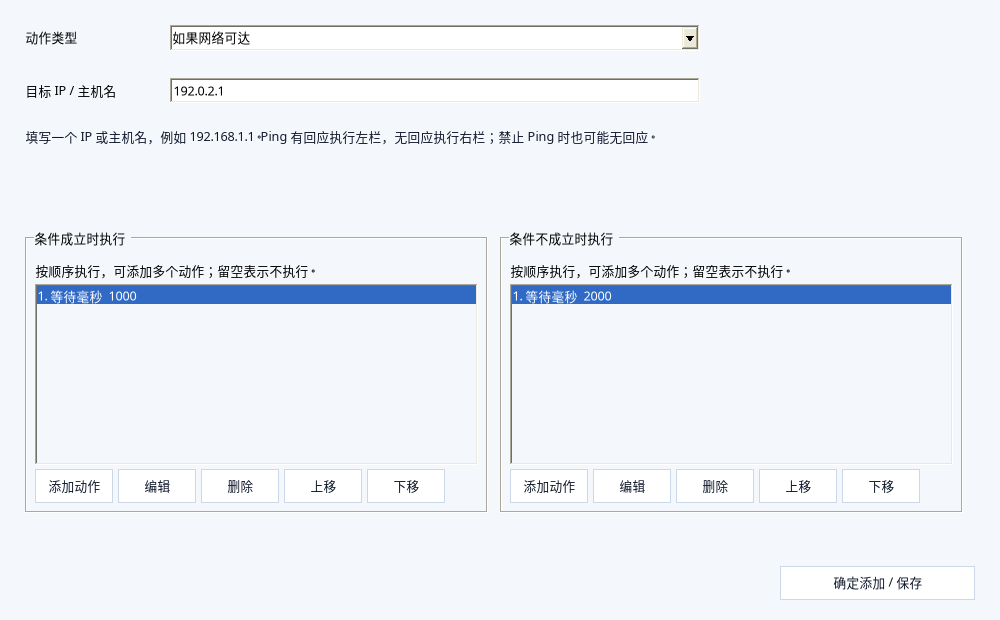

## 沿用 V0.5.9 的 U 盘、路由表与鼠标坐标

- **U 盘权限**：选盘时直接显示盘符及 NTFS/exFAT/FAT32 等格式；非 NTFS 禁用“NTFS 普通用户只读”和权限恢复，提前说明原因。格式校验在管理员/操作确认之前执行，执行时再次核对；常规失败显示可读原因。刷新和检查结束后仍按格式恢复按钮状态，不会格式化或转换文件系统。
- **非 NTFS 的保护选择**：FAT32/exFAT 没有 NTFS 权限，不能用同一种 ACL 方案。可用原有“开启本机 USB 写保护”，影响当前电脑的 USB 存储写入，需重新插拔并验证，**不会随 U 盘带到其他电脑**；跨电脑只读仍需硬件写保护。新界面不增加磁盘写入、策略或格式化操作。
- **路由与 MAC**：网卡、状态、MAC、IPv4、掩码、IPv6、网关列收紧，网关更靠前；IPv4/掩码/IPv6 仍独立相邻，状态表头横排，完整内容可悬停查看，超宽内容可横向滚动。
- **鼠标坐标**：抓取与 BAT 回放使用物理像素和临时逐显示器 DPI 上下文，结束后恢复线程 DPI 状态；不把读取失败时的逻辑坐标当作物理坐标。支持副屏负坐标，完成抓取后不强行切回编辑器。新增 **3 秒后测试移动**：抓取后先测试目标位置，再保存动作；失败保留原参数并显示原因。更换动作、关闭窗口会取消倒计时，倒计时期间不保存动作。
- 两种 BAT 引擎都使用相同鼠标移动桥接代码；成功调用后核对实际物理位置，超出容差或无法核对时报告失败。模拟检查不能代替真实 Windows 缩放、多屏和输入权限验收；分辨率/显示器布局变化后请重新抓取。

以下为 Linux/Mono 实际窗口，盘符、网卡及坐标均为测试注入；没有修改真实 U 盘权限/策略或移动系统鼠标：


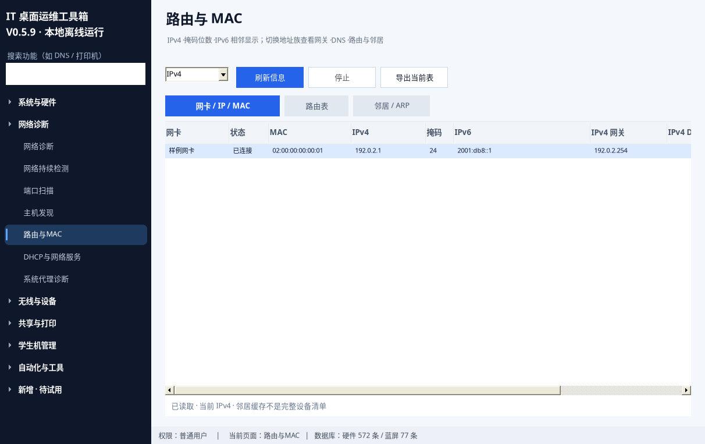


## 沿用 V0.5.8 的教室保存弹窗

扫描时只填网段。扫描完成后，勾选学生机并点击 **保存勾选**，弹出“保存到教室”窗口，填写 **教室名称**，点击 **确认保存** 即可。若此前选中了具体机房，弹窗默认带入该名称，也可以修改。

未勾选设备时先提示选择；教室名为空时留在弹窗中提示补填。点击“取消”或关闭弹窗不写入清单，扫描结果和勾选仍保留，方便继续核对后再保存。已有设备仍保留原分组，新设备才归入填写的教室。

以下为实际窗口，数据为测试样例：


## 沿用 V0.5.7 的扫描机房与右键卸载

**记录一次，以后选机房直接唤醒：**

1. 首次让学生机开机并连接机房有线网络，在“学生机管理 → 学生机与网络唤醒”选择教师机对应网卡，点击 **扫描网段并保存**。
2. 填写网段，点击扫描；结果以全宽表格展示 IPv4、MAC、名称、来源/状态。核对设备后勾选真实学生机，再点 **保存勾选**，在弹窗填写教室名称并确认。可修改新设备名称；打开扫描窗口不会自动扫描、保存或唤醒。
3. 重启工具仍读取原机房清单。以后选中机房，点击 **唤醒该机房**，不必再次扫描或录入 MAC。更换网卡或 MAC 后需更新记录；保存过 IP 的设备若换了网段，也应更新 IP 或留空。

扫描使用 Windows ARP 解析及所选网卡的本机邻居缓存，不做端口探测；原“主机发现”继续仅用 Ping。范围必须在所选接口局域网内，支持 /22–/32、每轮最多 1024 个地址、最多 12 个并发查询；默认对较大网络只取当前 /22 范围，可分段扫描。停止后不再启动后续查询，正在执行的系统 ARP 调用可能需要几秒返回。

ARP 能取得 MAC 不表示一定是学生机，也不保证当前在线；路由器、打印机和缓存结果需要人工核对。未取得 MAC 的行不可保存，同 MAC 对应多个 IP 的行会标记，批量勾选会跳过，核对后可手动选一条。完全关机且无可用缓存的设备可能无法发现，因此首次记录应在设备开机时进行。

清单继续使用 `%LOCALAPPDATA%\ITDesktopToolkit\students-v055.tsv`，升级不更换存储文件。同 MAC 再次扫描只更新 IP，保留原名称、机房和备注；未响应的旧记录保留。新设备保存到填写的机房，总清单最多 500 台。保存清单不自动发送唤醒包，实际 WOL 仍需 BIOS/网卡支持与待机供电。

**软件环境检查右键卸载：**在表格中右键选中软件，点击“卸载所选软件”。程序重新核对该条注册表登记和卸载路径，确认窗口显示软件及将启动的命令，确认后交给原厂卸载程序；取消不会启动。Windows Installer 项使用正常交互卸载。无有效卸载入口的项目可通过“在 Windows 设置中管理”处理。启动卸载程序后保留列表行，完成卸载后手动刷新核对；不会以删除目录或登记项代替卸载。此功能仅管理本机软件。

以下是 Linux/Mono 真实窗口，设备、软件和扫描/发送/卸载结果均由测试注入；没有扫描真实机房、唤醒真实设备或卸载软件：

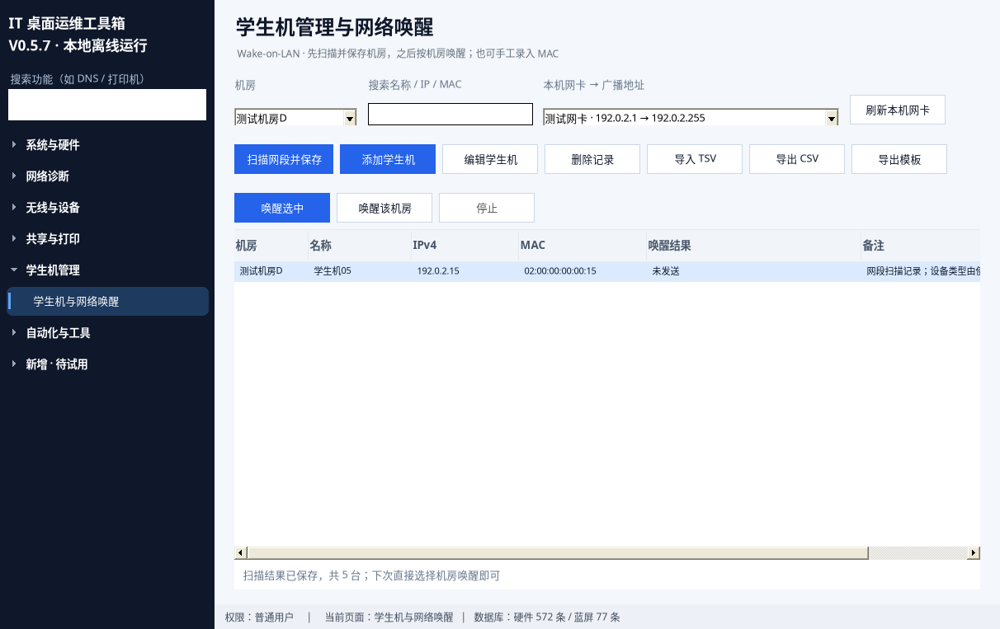

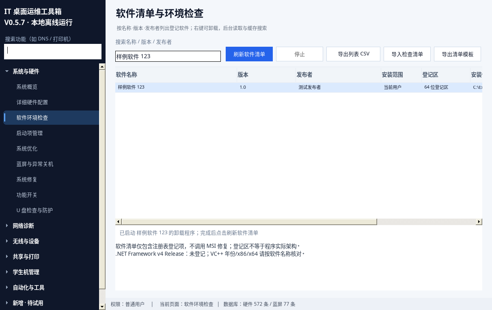

## 沿用 V0.5.6 的已保存 Wi-Fi

入口：**无线与设备 → 已保存的 Wi-Fi**。

- 直接打开铺满页面的表格，列出 **配置名称、SSID、安全类型、加密、密码、读取状态、无线网卡**。列宽随窗口分配，密码列留足最小宽度，长密码换行；窄窗口可横向滚动。
- 进入即在后台读取并直接显示可访问的明文密码，不再手填配置名或经过单独的确认/密码弹窗。支持刷新、停止、按配置/SSID/网卡搜索，以及复制当前行密码。
- 使用 Windows WLAN 原生接口读取，避免依赖 netsh 中英文文本。仅显示操作系统明确返回的明文；受保护内容不当作密码显示，权限/策略限制、开放网络、企业认证和未保存共享密码分别标明。
- 不修改无线配置，不自动连接网络；密码不写入日志、普通报告或自动保存文件。本页不提供文件导出。清空、刷新或离开页面会清除当前表格并释放当前密码数据引用；复制到剪贴板仅在点击复制时发生。
- 如果当前权限不允许读取，可由有权限的账户在工具箱管理员模式下刷新；组织策略或认证方式仍可能限制读取，软件不绕过这些限制。

以下为 Linux/Mono 实际表格预览，所有配置和密码均为测试样例，未读取真实无线密码：


## 沿用 V0.5.5 的路由与学生机功能

- “网络诊断 → 查看路由表”改为页内表格，与“路由与 MAC → 路由表”共用相同列和转换：**目标、掩码、下一跳、网卡、跃点、协议、地址族**。掩码仍为数字前缀位数，默认路由显示 0，IPv6 支持 0–128；不把目标和掩码拼在一起。
- **系统代理诊断**移至“网络诊断”分类，点击后才读取本机代理；其他四项辅助工具继续位于“新增 · 待试用”。
- 左侧新增独立的 **学生机管理 → 学生机与网络唤醒**，当前为 7 个分类、30 个入口。

以下为 Linux/Mono 实际窗口，地址、学生机和发送结果为明确的测试样例；测试没有向真实学生机发包：


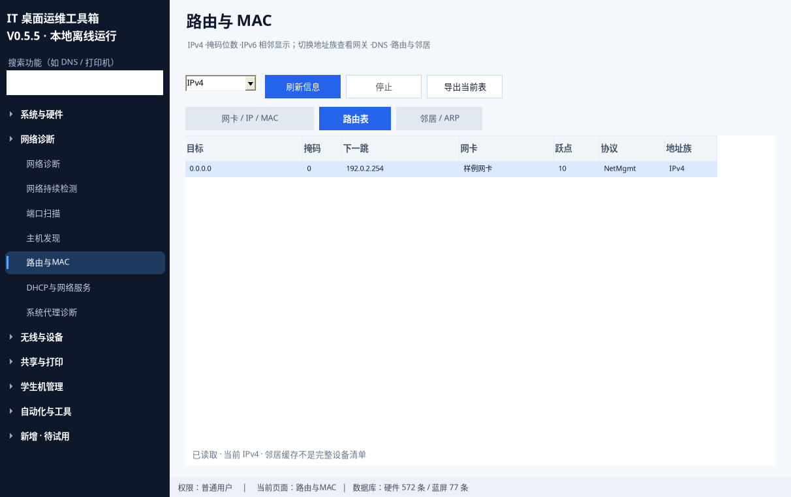


## 学生机清单与 Wake-on-LAN

1. 进入“学生机管理 → 学生机与网络唤醒”，可扫描网段勾选保存，也可手动添加机房、名称、**学生机有线网卡 MAC**、可选 IPv4 和备注。可以编辑、删除本机记录，按机房和关键词筛选；进入页面不会自动发包。
2. 清单自动保存在 `%LOCALAPPDATA%\ITDesktopToolkit\students-v055.tsv`。支持 UTF-8 TSV 模板/导入；同 MAC 更新记录，未导入的原记录保留，最多 500 台。导出 CSV 是当前表格视图及发送结果，已处理公式前缀；CSV 不作为 TSV 直接导入。
3. 选择教师机当前使用的本机 IPv4 网卡，界面显示源地址和根据实际掩码算出的广播地址，不固定使用 `.255`；支持 8–30 位的局域网子网。
4. 选中一台或多台后点“唤醒选中”；或先选择具体机房，再点“唤醒该机房”。**机房唤醒包含该机房全部记录，不受搜索文字限制**；“全部机房”不能直接批量唤醒。
5. 每个唯一 MAC 发送 3 个 UDP 9 魔术包，包间隔 80ms，不自动重试整批。开始前校验整批；填写了 IP 的学生机必须属于所选本机网段，IP 不固定时可留空按 MAC 唤醒。
6. 表格区分“已发送，未确认开机”和发送失败。UDP 交给系统发送不表示设备收到或已经上电；支持停止/切页取消，已发出的包不能撤回，取消中的部分发送数量会保留。

原理是向所选局域网广播标准魔术包（6 个 FF 字节后重复目标 MAC 16 次）。支持 WOL 的学生机网卡在待机供电下识别该包，并通知主板唤醒；不需要安装学生机客户端，也不通过用户名密码远程登录。

需要在实机核对以下条件：

- 学生机 BIOS/UEFI 启用 Wake-on-LAN、PCI-E 唤醒等对应选项；Windows 有线网卡驱动启用魔术包唤醒及允许唤醒。不同硬件对睡眠、休眠、关机状态支持不同，快速启动也可能影响关机唤醒。
- 学生机仍接通电源和网线，关机时网卡仍有待机供电；断开电源/插座关闭无法靠软件唤醒。
- 教师机与学生机位于同一广播域/VLAN，交换机/AP 不阻断所需广播。普通跨 VLAN、公网唤醒不在本版范围，学生机无线网卡的 WoWLAN 也不保证适用。
- 首次记录 MAC 应在学生机开机时扫描或从系统信息取得；关机且无缓存时，不能仅凭 IP 自动得出其 MAC。先用一台启用 WOL 的测试机验证，再使用机房批量操作。

## 沿用 V0.5.4 的表格与导出

- 路由/MAC 保留独立的 **IPv4、掩码、IPv6** 三列，掩码显示 `24`、`20` 等前缀长度，不写成 `255.255.255.0`，也不拼入 IPv4 地址。掩码列收窄，IPv6 紧邻显示；地址族切换只影响网关、DNS、路由和邻居。
- Wi-Fi 的 SSID 列加宽；表头直接使用频率、信道、信号、RSSI 等短名称。基本速率及收发速率用 `Mb`，数值仍为 Mb/s，不换算成 MB/s。频率数值仍为 MHz，RSSI 为 dBm，单位保留在悬停提示中。
- 信号写成 `82%`，百分比跟随数字；RSSI 移到前部，声明速率集放到最后。信号列按数值排序，CSV 也保留百分比。
- 配置预览与导出都按部件压成一行，例如 `内存：金百达 16G 3200MHz ×2`。相同配置的内存条合并数量，不同配置用 ` + ` 连接；未知厂商/频率不猜测。
- 新配置报告为 **V2 可读 TXT**，不再把原始参数逐项导出。系统、CPU、主板、内存、显卡、磁盘各一行，网卡每块一行；保留采集完成后询问导出。仍支持导入 V1 报告，对比时先转为相同的部件摘要，避免仅因文件格式变化出现差异。`G` 是原报告 GiB/GB 容量数字的简写，未修改容量或推算内存频率。

以下均为 Linux/Mono 实际界面，内容为排版测试样例：


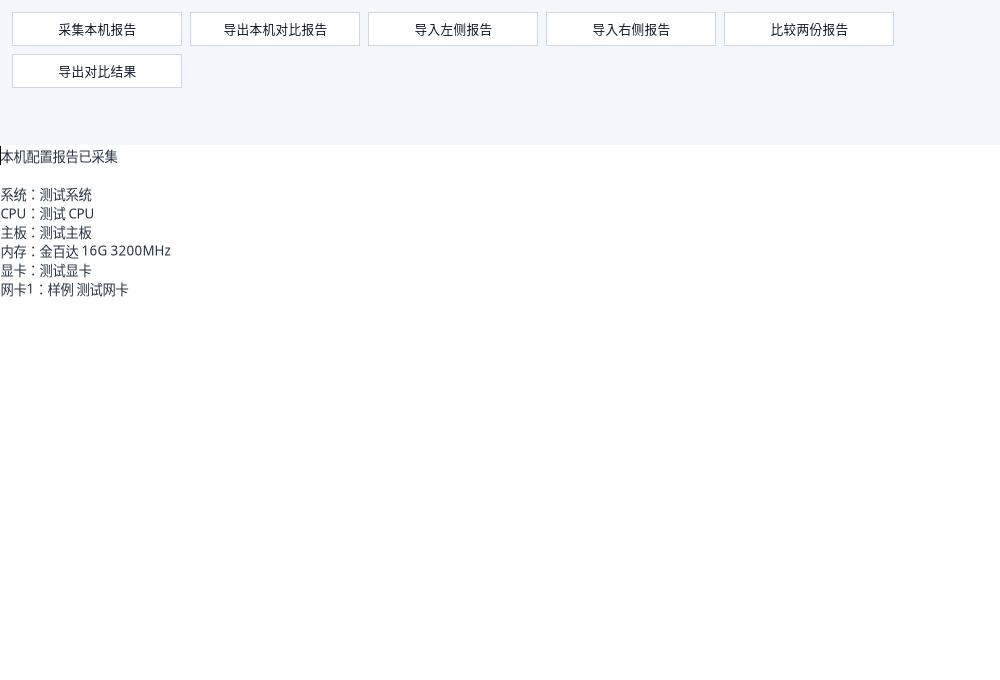

[可读配置 TXT 样例](docs/configuration-v054.txt)

## 沿用 V0.5.3 的主要功能

- 每次启动固定进入 **系统概览**，不恢复上次页面。搜索清除图标放入输入框内，有文字时才显示，支持悬停反馈。
- **软件环境检查**显示软件名称、版本、发布者、安装范围、登记区、安装位置，V0.5.16 再增加对照结果列；读取放在后台，搜索使用本次缓存，可导出 CSV，手动刷新更新缓存。登记区不等于程序实际架构。
- 启动项的图标/命令列设置合理宽度与最小宽度；表头保持单行，不再挤成竖排。图标在后台读取，同一命令只提取一次，刷新或离开页面释放图像资源。
- 路由/MAC 继续使用直接操作页和横向滚动，IPv4/掩码/IPv6 的最新布局见上方 V0.5.4。
- BAT 保留 ☰ 拖动排序，移除上移/下移按钮，新增 **复制动作 / Ctrl+D**：完整复制所选动作及三个参数，插入下一行并选中，双击后可独立修改。
- 本机配置报告改为系统/Build/架构、整机、CPU、主板、BIOS、内存、显卡、磁盘、网卡和 IP 配置。新报告不查询服务、SMB 策略或共享目录；旧格式报告继续可导入，V0.5.4 导出部件摘要。采集成功后询问是否导出，选择否保留窗口中的结果，关闭采集窗口会请求取消。
- “新增 · 待试用 → 网络配置核对”的表格铺满可用宽度，说明列留出更多空间；除代理已移至网络诊断外，其他四项试用功能继续留在原分类。

性能方面：启动时的大型编号库改在后台加载，窗口先显示；重载使用新数据库实例，扫描保留自己的读取实例。软件列表批量回填、缓存搜索；报告一次更新全文；硬件 WMI 对象及时释放，离开硬件页会请求停止后续查询。已通过慢数据库任务下的窗口可用性检查；没有 Windows 实机耗时数据，不宣称固定加速比例。

以下为 Linux/Mono 实际窗口，软件与自动化内容为明确的测试样例：


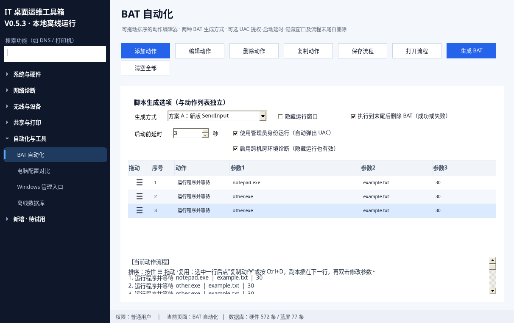

## 网络辅助工具（V0.5.2 起）

系统代理诊断位于 **网络诊断**，其余四项位于 **新增 · 待试用**；进入页面不会自动执行。点击查询/读取后显示结构化表格，支持停止、切页取消和 CSV 导出，待逐项试用后再决定是否保留。

| 工具 | 用途与边界 |
| --- | --- |
| DNS 记录查询 | A、AAAA、CNAME、MX、TXT、NS、SRV、PTR；可指定 DNS 服务器 IP，支持国际化域名、IPv4/IPv6 反查，不修改 DNS 设置。使用 Windows Resolve-DnsName |
| ICMP 路由跟踪 | IPv4，每跳一次标准 ICMP，默认最多 16 跳、上限 30 跳，单跳超时 1200ms；不进行 TCP/SYN 探测，星号/超时不能证明设备故障 |
| 本机连接与监听 | TCP 连接/监听、UDP 本机绑定、PID/进程；默认只列 TCP 监听项，UDP 始终列本机绑定，每种协议最多 500 行，不测试远端可达性 |
| 系统代理诊断 | 当前用户代理/PAC 设置、四项常见代理环境变量、WinHTTP 配置；隐藏 URL 凭据和路径/参数，不下载 PAC、不探测 WPAD、不更改设置 |
| 网络配置核对 | 本机已连接接口的 IPv4、APIPA、掩码、网关子网、DNS 配置和本机重复地址；不发 ARP/Ping，不把本机配置检查当作局域网冲突检测，暂不核对 IPv6 |

DNS 查询和 ICMP 路由跟踪在点击执行后会发送网络请求；使用主机名跟踪还会解析名称。其余三项仅读取本机。原有 **主机发现仍然只用 ICMP Ping**，不依据 TCP 端口判断主机是否在线。Ping/路由跟踪也可能被网络管理平台记录，软件不能保证不触发组织策略告警。

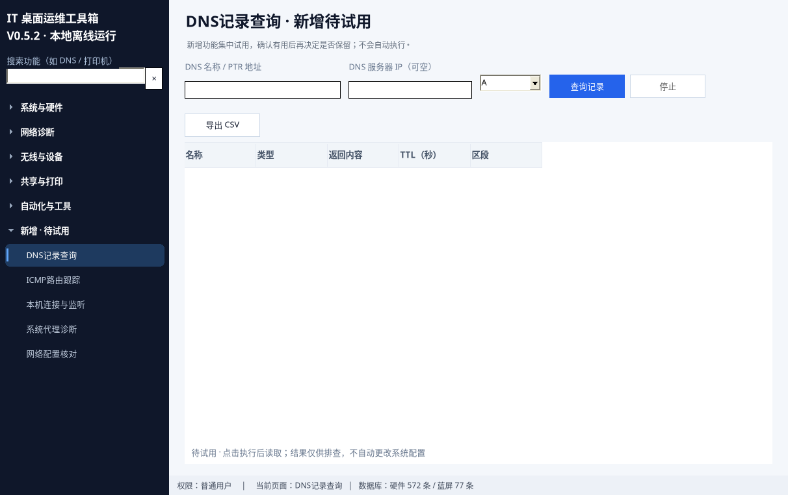

## 离线硬件库扩充

- 收录 **406 条主板型号名称精确规则**与 **23 条内存/SSD 家族前缀规则**，连同原库共 **572 条硬件规则**。主板名称来自 LibreHardwareMonitor，不从型号字符串猜制造商或 PCB 修订。
- 附带 PCI 2026.11.15 快照：**2526 个厂商、21819 个设备 ID**；USB 2026.06.26 快照：**3427 个厂商、20537 个设备 ID**。可补充显卡、网卡、存储控制器、USB 外设等芯片名称，不能保证每个零售型号、显存或整机 SKU 均可确定。
- 型号名称精确匹配优先于家族前缀和普通关键词，详情显示规则来源与匹配依据；家族规则不推断容量/频率/颗粒。未知设备保留系统原始信息。
- 新库为独立版本文件，不覆盖用户原有 `hardware_models.tsv`、`pci.ids`、`usb.ids`；用户 ID 条目在上游快照后加载，同 ID 优先。编译只补入运行目录缺失文件。
- 来源、哈希和许可见 [Database/SOURCES-v052.md](Database/SOURCES-v052.md)，完整许可及主板提取源文件随包附带。应用不自动联网更新数据库。以上数量为原始附带库，用户编辑后会变化。

## 导航与界面

左侧改为 **7 个可折叠分类、30 个二级入口**，默认只展开一个分类；顶部支持中文名称和关键词搜索，例如 `DNS`、`WiFi`、`打印机`、`MAC`。搜索只筛选入口，不自动执行检查；按回车打开首个匹配入口，清空搜索恢复分类。程序在本次运行中保留折叠状态；重新启动固定打开系统概览。

| 分类 | 功能 |
| --- | --- |
| 系统与硬件 | 系统概览、硬件配置、软件环境、启动项、系统优化、蓝屏/异常关机、系统修复、功能开关、U 盘防护 |
| 网络诊断 | 网络配置/连接测试、持续检测、端口扫描、主机发现、路由与 MAC、DHCP/服务检查、系统代理诊断 |
| 无线与设备 | Wi-Fi 分析、已保存的 Wi-Fi、ONVIF 摄像头发现 |
| 共享与打印 | 共享文件夹、SMB/NTFS 权限、打印机与服务 |
| 学生机管理 | 网段扫描保存、机房清单、按 MAC 网络唤醒 |
| 自动化与工具 | BAT 自动化、电脑配置对比、Windows 管理入口、离线数据库 |
| 新增 · 待试用 | DNS 记录查询、ICMP 路由跟踪、本机连接与监听、网络配置核对 |

以下沿用 V0.5.1 排版预览；上方新图展示 V0.5.2 试用分类。截图为 Linux/Mono 实际界面预览，Windows 的字体和窗口装饰可能略有不同：

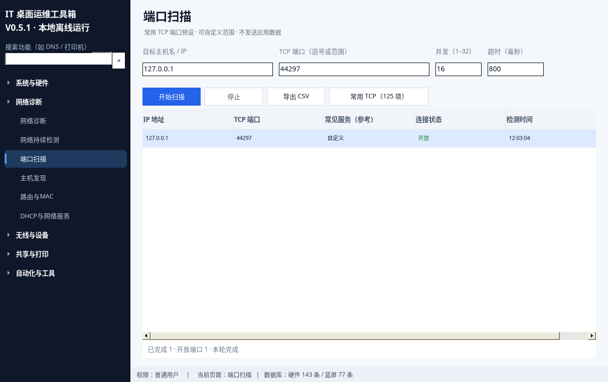

端口扫描、主机发现直接进入表格与输入区；路由/MAC、Wi-Fi 分析进入后自动读取，不再多点一次“打开”。统一字体、配色、按钮和表格，旧“安全与维护”展开状态会迁移到“系统与硬件”。切换页面会取消该页进行中的读取/检测。

Wi-Fi 表格预览（以下是用于排版测试的样例数据，不是真实无线扫描结果）：


常用网络工具的使用方法：

- **端口扫描**：默认载入 **125 个常用 TCP 端口**，涵盖文件共享、邮件、远程管理、Web、数据库、打印等，也可手动填写端口或范围。端口列表与常见服务名位于 `src/CommonPorts.cs`；这是常用预设，不包含所有可能的服务端口或 UDP 检测。仅验证 TCP 握手，不发送应用数据；区分开放、拒绝、超时与连接错误。每次最多 1024 个端口，并发 1–32，单次连接超时 100–10000 毫秒。
- **主机发现**：输入 IPv4 或 `/24` 至 `/32` 的 CIDR 网段，例如 `192.168.1.0/24`。只执行 **ICMP Ping**，不再尝试任何 TCP 端口；展示响应状态与往返延迟。最多 256 个地址，无响应不等于离线，关闭 ICMP 的设备可能不响应。
- **路由与 MAC**：进入即只读加载，分别用“网卡/IP/MAC”“路由表”“邻居/ARP”三张表显示；IPv4 和 IPv6 同行分列，掩码另列位数；地址族切换控制网关、DNS、路由和邻居，支持横向滚动。邻居缓存不是完整设备清单，MAC 前缀不能证明整机品牌。
- **DHCP 与网络服务**：显示当前 DHCP 配置、服务器、租约和相关服务；可分别测试 DNS、TCP、HTTP。HTTP 仅发送 HEAD，保持证书校验，不自动带账号密码，不跟随跳转。401/403/405 等也属于服务响应，不代表业务正常。DHCP 页面只读取本机信息，不发送租约申请，不能排除其他 DHCP 服务器或冲突。
- **Wi-Fi 分析**：通过 Windows WLAN API 结构化读取，进入即加载。默认显示附近热点表，可切换到无线接口/当前连接表。分别列出接口 MAC、热点 BSSID、网络类型、无线制式、频段、频率（MHz）、信道、信号（% / dBm）、基本速率、声明速率集和当前收发速率（Mbps）。不依赖 `netsh` 的中英文排版。
  - 附近热点来自系统缓存，刷新读取不保证缓存立即更新；不自动连接或更改无线配置。
  - 基本速率来自热点速率集的基本标记，声明速率集为系统报告的支持速率；二者不等于当前连接速率或实际下载速度，也不保证包含所有现代 PHY 的 MCS 能力。
  - 当前接口收发速率单独列出，不用热点声明速率集冒充实时速率。未提供的数据明确显示“未知”；非 UTF-8 SSID 用十六进制保留原始字节。
  - 部分 Windows 版本要求开启位置服务，读取也可能受服务状态、网卡和组织策略限制。失败会显示原因，不以空表冒充成功。
  - 表格支持排序和横向滚动，CSV 按可见列顺序导出，并处理网络名称导致的公式注入。
- **已保存的 Wi-Fi**：进入即用全宽表格列出配置及系统允许读取的明文密码，无额外确认弹窗；受限项显示原因，支持搜索、刷新、复制密码和清空显示。该页不提供文件导出，普通报告不包含密码。
- **摄像头发现**：选择本机局域网 IPv4 网卡，发送 ONVIF WS-Discovery 组播，等待 5 秒。只显示与当前请求匹配的设备声明，不登录、不自动访问声明地址。回复未经认证，不能仅凭声明认定设备身份；跨 VLAN、组播/防火墙限制或不支持发现的设备可能没有结果。

检查均支持停止。扫描过程中只启用停止按钮，避免任务重叠；关闭窗口会先请求停止。除已保存 Wi-Fi 密码页外，结果可导出；未完成的目标不产生检测结论。本版未增加数据包抓包、主动 DHCP 服务器发现、会话压力测试、AI 助手；这些需要另行设计依赖和验证，菜单没有空入口。

## 编译与启动

1. 下载并完整解压源码包，不要只复制 `src` 文件夹。
2. 在 Windows 10/11 上运行 `Build_Only.bat` 编译，或运行 `Build_And_Run.bat` 编译并启动。
3. 程序位于 `build/ITDesktopToolkit.exe`。移动程序时须同时携带 `build/Database`。
4. 普通检查不主动提权；修改打印队列、系统设置或 USB 写保护时按界面提示使用管理员权限。

编译使用 Windows 自带 .NET Framework C# 编译器，脚本会检查编译器是否存在；不需要还原 NuGet 包。运行依赖 Windows PowerShell 5.1 与相应的 Windows 管理接口。

## 沿用 V0.4.6 的功能

- **所选 NTFS U 盘普通用户只读**：在“U 盘检查与防护”中选盘，设置或恢复权限。设置前备份原权限；普通 Windows 用户可读取，管理员仍可写入。只支持 NTFS，不格式化 U 盘；严格跨电脑只读仍需硬件写保护。
- **取得指定文件夹权限**：选择文件夹，递归把 Administrators 设为所有者并授予完全控制。操作结果会列出失败项。
- **BAT 清空回收站**：添加“清空当前用户回收站”动作，永久清理 BAT 实际运行账户在所有驱动器的回收站。此动作不能放入自动重试块。

## 沿用 V0.4.5 的功能

### 电脑配置对比

入口：**自动化与工具 → 电脑配置对比 → 打开电脑配置对比**。

- 在正常电脑和异常电脑上分别点击“采集本机报告”；成功后询问是否立即导出，选择否则可继续查看，稍后用“导出本机对比报告”保存。
- 在同一个窗口导入左、右两份报告，点击“比较两份报告”。
- 按系统/Build/架构、整机、CPU、主板、内存、显卡、磁盘和网卡摘要逐行对比；内存合并厂商、容量、报告频率与数量，不散列插槽或零件号。新报告没有服务、SMB 策略或共享目录；可选设备读取失败保留提示，系统或 CPU 关键信息失败不能当作成功。
- 差异结果可另存为文本。新版对比报告为可读的 V2 TXT，仍可导入旧版 V1 编码报告；报告包含电脑名、MAC 和 IP 地址，分享前请检查内容。

这是用于排障的报告对比，不会自动修改配置或同步两台电脑，也不提供配置快照还原。

### 打印机专项诊断

入口：**共享与打印 → 打印机与服务 → 打印机专项诊断**。

- 查看默认打印机、脱机状态、驱动、端口和各打印机的排队任务。
- 输入打印机 IP/主机名与端口（默认 `9100`）测试 TCP 连通性，不发送打印数据。
- 输入诊断报告中的准确打印机名称，经确认后取消该打印机的全部排队任务，不清空其他打印机队列。
- 导出诊断结果。取消任务不能撤销；TCP 可连接不等于驱动、耗材或出纸机构正常。

### 网络质量持续检测

入口：**网络诊断 → 网络持续检测**。

- 输入网关、内网服务器或外网目标，以逗号分隔，最多 8 个主机名/IP。
- 设置采样轮数（1–10000）和轮间隔（1–3600 秒），点击开始。
- 每轮并行检测，之后等待轮间隔；记录带时区时间、响应状态和延迟。
- 实时显示最近 20 条，统计无响应/错误比例、最小/平均/最大延迟、相邻成功采样的平均延迟变化。
- 支持停止以及导出完整 CSV。开始新一轮前会提示清空上一轮记录。

检测使用 ICMP。主机禁用 ICMP、名称解析失败、本地权限或网络故障都可能造成检测失败，不能仅凭无响应断定目标断网。DNS 解析耗时也可能影响停止速度。

### 软件清单与环境检查

入口：**系统与硬件 → 软件环境检查**。

- 进入即后台读取本机/当前用户、32/64 位注册表，七列表格展示对照结果、名称、版本、发布者、范围、登记区、安装位置；显示 .NET Framework v4 Release，VC++ 年份/架构按清单项核对。
- 搜索在已读取缓存中筛选；再次进入沿用缓存，点击“刷新软件清单”重新读取，支持停止、列表 CSV 导出。
- 不使用可能触发 MSI 修复的 `Win32_Product` 查询。
- 标准清单建立/编辑/导入/导出以及多出软件右键卸载见本版说明。
- 原关键词/最低版本检查位于“标准清单 → 版本检查”，支持导入 UTF-8 软件要求清单、导出模板与检查结果。

清单每行格式为：`软件名称关键词<Tab>最低版本`，最低版本可省略。例如：

```text
Google Chrome	120.0
Microsoft Visual C++
```

关键词匹配不区分大小写。检查结果区分符合、缺失、版本偏低及版本需人工核对。登记清单不能覆盖全部便携软件和其他用户的应用；检查特定运行库架构时，应使用包含年份、x86/x64 的具体名称关键词。

### BAT 条件、分支与失败重试

入口：**自动化与工具 → BAT 自动化 → 添加动作**。条件动作使用上方两栏编辑，以下说明底层展开流程及重试参数，原有工作流文件格式继续兼容。

| 新动作 | 参数与行为 |
| --- | --- |
| 如果文件存在 | 文件完整路径；只判断文件，不判断文件夹，两栏分别设定存在/不存在时的动作 |
| 如果网络可达 | 目标 IP / 主机名为单个目标，两栏按 ICMP 是否有回应分支 |
| 如果系统版本 | Build 下限及可空的上限；例如 Win11 初始 Build 为 22000 |
| 否则 / 结束条件 | 两栏编辑保存时自动生成；旧流程仍支持省略否则，每块最多一个 |
| 重试开始 / 重试结束 | 参数 1 为总尝试次数（1–10，默认 3），参数 2 为失败后等待秒数（1–300，默认 2） |
| 检查文件存在 | 文件不存在则报错，适合放在重试块中等待外部程序生成结果 |
| 运行程序并等待 | 参数 1 为路径，参数 2 为启动参数，参数 3 为超时秒（1–86400，默认 60）；非零退出码或超时算失败 |

示例：

```text
如果文件存在       D:\Tools\check.exe
  重试开始         3                 2
    运行程序并等待 D:\Tools\check.exe  /check  60
  重试结束
否则
  运行程序         notepad.exe
结束条件
```

条件/重试最多嵌套 8 层，保存及导出时检查结构是否闭合。失败重试会重新执行整个块，使用者须确认其中操作可重复执行；格式化、删除和清空回收站动作不能放入重试块。程序超时仅尝试结束主进程，不能保证结束其启动的全部子进程。

### U 盘检查与本机防护

入口：**系统与硬件 → U 盘检查与防护**。按本版需求，**不提供资料恢复、自动删除、格式化或自动清理**。

只读检查：

- 从 Windows 识别的可移动存储中选择 U 盘，检查隐藏属性、`autorun.inf`、文档伪装的双扩展名、同名文件夹/程序。
- 读取 `.lnk` 快捷方式指向和参数，提示调用命令/脚本解释器的情况，不执行目标。
- 为不超过 64 MiB 的可疑文件计算 SHA-256；跳过重解析点，最多遍历 50000 个文件/目录、保留 5000 条发现。
- 支持中止、导出报告、按盘符查看 Defender 历史，以及导入其他杀毒软件的文本报告供人工核对。
- **可疑迹象不等于病毒确诊，未发现迹象不等于安全。** Defender 历史可能缺失、受权限限制，也可能对应过去使用同一盘符的其他设备。

本机防护：

- **关闭当前账户自动播放**：设置该账户 `NoDriveTypeAutoRun=255`，影响所有驱动器的自动播放，可能需要重新登录。
- **开启本机 USB 写保护**：管理员设置本机 `StorageDevicePolicies\WriteProtect=1`，通常需要重新插拔，可能影响其他 USB 存储设备。
- 修改前保存原值，可分别还原首次保存的原策略值；还原按钮恢复的是策略设置，不是 U 盘文件。
- 备份按当前运行账户保存在 `%LOCALAPPDATA%\ITDesktopToolkit`，还原时请使用相同账户。

NTFS U 盘权限：选中可移动 U 盘后，可以递归把普通用户设为读取和运行、SYSTEM 设为所有者并保留完全控制、Administrators 保留完全控制。修改前会将原权限备份到当前账户的 `%LOCALAPPDATA%\ITDesktopToolkit`，可通过“恢复所选 U 盘原权限”还原；全部恢复成功后删除备份以便再次设置。只支持 NTFS，不格式化 U 盘；遇到重解析点或无法读取的权限会停止。系统目录 `System Volume Information` 和 `$RECYCLE.BIN` 不参与递归修改。此设置只限制遵守 NTFS 权限的 Windows 普通账户，管理员仍可写入或修改权限。也可选择指定文件夹，递归把 Administrators 设为所有者并授予完全控制；操作结果会显示失败项。

**本机软件写保护仅影响设置过的电脑，不会跟随 U 盘到其他机房电脑，也不阻止手动执行恶意程序。** 组织策略、设备驱动可能影响生效，写入策略成功后仍应重新插拔并验证。需要跨电脑阻止写入时，应选择带物理写保护开关的设备。

## 保留的原有功能

系统与硬件概览、显示器/EDID、网络配置与诊断、蓝屏/异常关机、系统修复、启动项、电源、SMB 共享模式与权限、NTFS 权限、输入法、鼠标键盘自动化及离线故障库。

本版未添加资产管理、维护 U 盘启动器或配置快照功能。

## 测试与验证

当前 Linux 云环境已完成：使用微软 .NET Framework 4.5 引用程序集的完整源码 Mono/C# 5 编译和成品类型归属检查、**521 项检查（原有功能/脚本 109 + 网络工具 34 + 工作区/WLAN 数据 49 + 新增工具/数据库 36 + 桌面配置/列表 113 + 学生机扫描/唤醒 41 + 界面导航 139）**，以及原有离线数据库加载/查询冒烟检查。当前只剩原有 `NetworkConfigService.cs` 的 1 条未使用变量警告。

本次增加 7 项模板部署/规范化校验/篡改拒绝/缺失/大小限制/主程序不嵌入内核及共用启动检查；另核对 96 份自动化 BAT 与旧版字节相同，清理模拟用例继续通过。外置模板不改变业务逻辑，所需路径变量统一；没有完成实际火绒或 Windows 验证。此前增加 8 项清理脚本生成/模式/数据引用/不留结果文件/完整 BAT/UAC/空标准拒绝/原子导出检查，以及 4 项生成窗口选择/取消/标准数据传递检查。另在 Linux PowerShell 7.4.13 运行实际导出内核的模拟用例，覆盖真假模式、取消、保护项、静默回退、登记变化、卸载残留、超时、MSI 参数、路径拒绝、原用户处理、管理员阶段和重启/取消结果；没有调用真实卸载、注册表或 UAC。Windows 入口同样包含该用例，实际 Windows 仍待验收。此前增加标准清单规则/去重/发布者/版本策略/原始卸载身份/格式拒绝/大小限制/原子保存等 20 项检查，以及实际窗口的建立、取消、勾选保存、多出筛选、排序后卸载确认、缺少条目禁卸载、导入导出、保存失败、重新载入和不完整读取等 19 项检查。卸载使用模拟计划和启动器，没有运行真实卸载程序。此前增加 11 项超时生成/校验检查；另在经官方 SHA-256 核对的便携 PowerShell 7.4.13 中完成 4 个脚本运行用例（真假/异常/模糊结果、缩短为 1 秒的超时、否则分支及超时/错误后不继续动作），并核对 Command 调用返回失败码。Windows 入口也调用相同用例，云端尚未执行 Windows PowerShell 5.1。此前增加可见清理不启动隐藏/分离进程，以及清理开关、精确路径、警告和退出块的两项交叉核对；Windows 入口增加只删除临时测试 BAT 的原生用例，分别保留退出码 0/7，不执行任何自动化动作，云端尚未执行该 Windows 用例。此前新增 32 组生成选项交叉核对、启动命令可读性/长度、工作流精确保留、按需加载组件以及界面选项不变检查；Windows 另加入 UAC 请求/取消/已有管理员的模拟用例，不实际提权，所有生成的启动段也纳入语法解析。云端尚未执行 Windows 用例或火绒实测。此前新增检查覆盖随机等待的范围、含上下限/相同边界、输入拒绝、两个引擎的运行时抽取、重试内抽取、保存兼容与失败保留原文件，以及随机等待窗口的默认范围、错误提示、编辑和导出。Windows 测试新增随机抽取运行用例，以替身拦截等待，不实际休眠，并核对范围及每次重抽；当前云端未运行 Windows PowerShell 用例。此前检查覆盖三类条件的双分支组合、嵌套边界、旧流程兼容、草稿独立性、整块移动/复制、工作流保存读取，以及真实窗口添加分支动作、隐藏无关参数、错误阻止提交、重开条件和取消不改原流程。条件编辑测试不执行 Ping、程序或分支内动作。此前检查覆盖文件系统权限支持、exFAT/NTFS 选盘与刷新按钮状态、紧凑网卡表、物理坐标倒计时/负坐标/测试移动/失败保留参数/切换取消。鼠标桥接代码用模拟原生接口编译执行，验证两种 BAT 引擎共用代码、DPI 上下文恢复、拒绝无保证的逻辑坐标回退及位置核对失败；没有调用真实鼠标、U 盘权限或策略接口。此前检查覆盖保存弹窗默认教室、未确认不写入、取消保留勾选、空名称不保存，以及确认后保存并选中教室。此前检查覆盖扫描范围/并发/停止、ARP 与缓存状态区分、重复 MAC、保留原名称/分组/未响应记录、扫描保存后重新进入读取、选机房无需重扫唤醒，以及卸载路径解析、MSI 交互参数、右键筛选项身份与取消不启动。扫描和卸载均使用模拟，不执行真实 ARP 扫描或卸载；Windows 原生接口仍待实机验收。原有检查覆盖已保存 WLAN 配置 ABI/列表、XML 实体阻断、明文与受保护密钥区分、权限状态、停止时丢弃迟到结果及全宽表格；无线测试使用固定演示密码，不调用真实密码读取。原有检查覆盖路由目标/前缀拆列、WOL 包格式、实际掩码广播、清单原子保存/重复合并、整批预检/取消、学生机真实窗口新增编辑与机房范围。WOL 发送采用模拟传输验证，不向真实学生机发包；实机唤醒能力仍需硬件验收。原有检查覆盖 CIDR/端口边界、并发上限、取消、TCP 无数据握手与连接关闭、HTTP HEAD/不跟随跳转/取消、命令退出码与错误输出、ONVIF 回复关联及禁用外部实体、菜单搜索/折叠/位置记忆、WLAN 原生结构大小和偏移、频率与速率换算、纯 Ping 调度，以及直接页面/自动读取/真实回环 TCP 扫描/快速切页取消。界面测试通过 Xvfb/Mono 实际创建窗口并生成截图，不等同于 Windows 设备接口验收。当前 Linux ICMP 组件缺失的探测错误会如实记录，不计作 ICMP 连通成功。

Windows 自动验证入口（使用系统 .NET Framework C# 编译器）：

```powershell
powershell -NoProfile -ExecutionPolicy Bypass -File tests\Run-Windows.ps1
```

仓库新增 `.github/workflows/windows-validation.yml`，推送 main 或创建 PR 后在 Windows runner 上编译并运行七套测试、解析生成的 PowerShell，再执行条件/重试及 DNS/连接表格/硬件配置报告模拟用例。新增模拟用例替换系统查询，不访问真实 DNS 或远端服务。可在 GitHub Actions 查看实际结果，不能用工作流文件的存在代替运行通过。测试不会修改 USB 策略、打印队列或读取真实 Wi-Fi 密码；导航测试会保存并恢复其使用的导航配置文件。

跨编译工具位于 `tools/build_framework.py` 与 `tools/verify_windows_refs.py`，开发依赖见 `tools/requirements-build.txt`。Linux 检查入口为 `tests/run-mono.sh`；在已有 Mono 开发环境与虚拟显示的云工作区中，设置 `DISPLAY` 后运行 `tests/run-navigation-ui-mono.sh`。这两个脚本使用当前云环境 `/workspace/cloud-setup` 中的工具链。

当前云主机没有 Windows。WLAN 数据解析使用原生格式测试缓冲区验证，UI 截图中的无线数据为测试样例，不能代替真实无线网卡/权限验收。真实无线接口/密码权限、DHCP/路由管理接口、ONVIF 设备、U 盘策略及打印机仍需实机验收，步骤见 [tests/Windows验收.md](tests/Windows验收.md)。

V0.4.6 的回收站动作仅在自动化用例中验证生成与结构，测试不会真正清空回收站；本次合并保留所选 NTFS U 盘只读、原权限恢复与指定文件夹权限取得功能。

## 文件与日志

- 原始离线库：`Database/`；运行时库：`build/Database/`，编译不会覆盖其中已有的用户编辑。
- 旧导航状态文件 `navigation-v050.txt` 不再读取或写入；启动固定显示系统概览。
- 软件标准清单：`%LOCALAPPDATA%\ITDesktopToolkit\software-baseline-v1.tsv`；仅存软件名称/发布者，更新程序或编译不覆盖。可从“标准清单”导出到其他电脑。
- 学生机清单：`%LOCALAPPDATA%\ITDesktopToolkit\students-v055.tsv`；编译不覆盖本机清单。
- 本地日志与策略原值备份：`%LOCALAPPDATA%\ITDesktopToolkit`。
- 本版文件校验：`SHA256SUMS.txt`。这是 V0.5.22 的完整发布基线，不能与旧版本哈希混用。
- 版本演进与历史记录：[版本更新记录_累计.txt](版本更新记录_累计.txt)。
