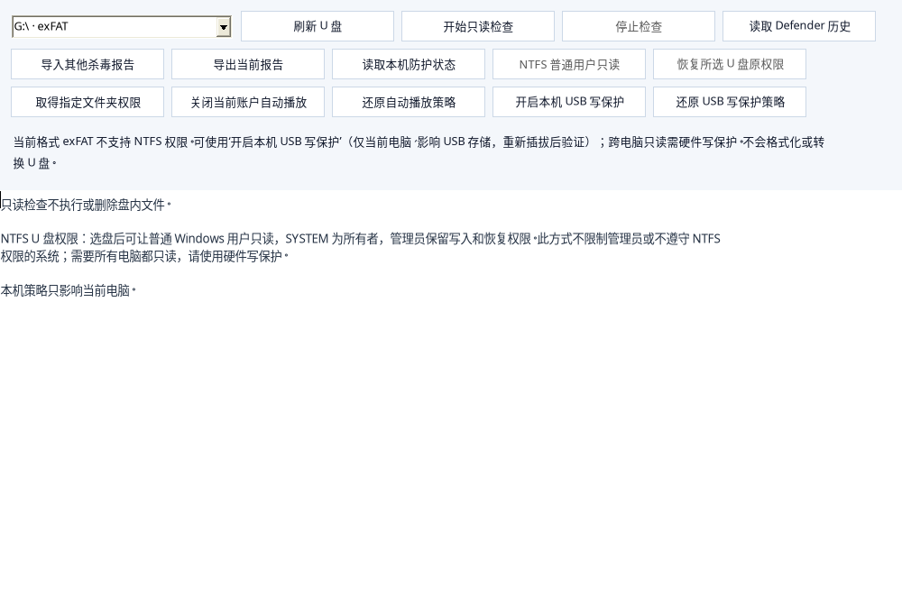
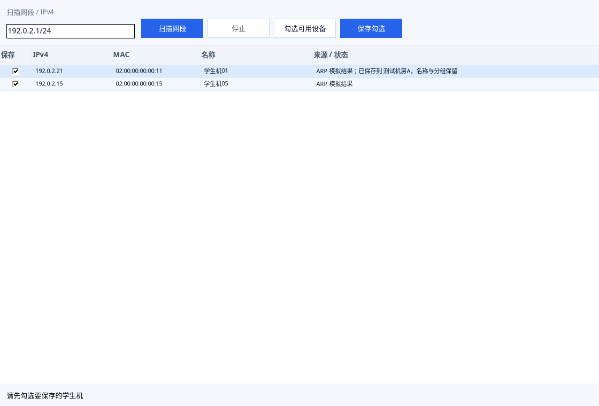
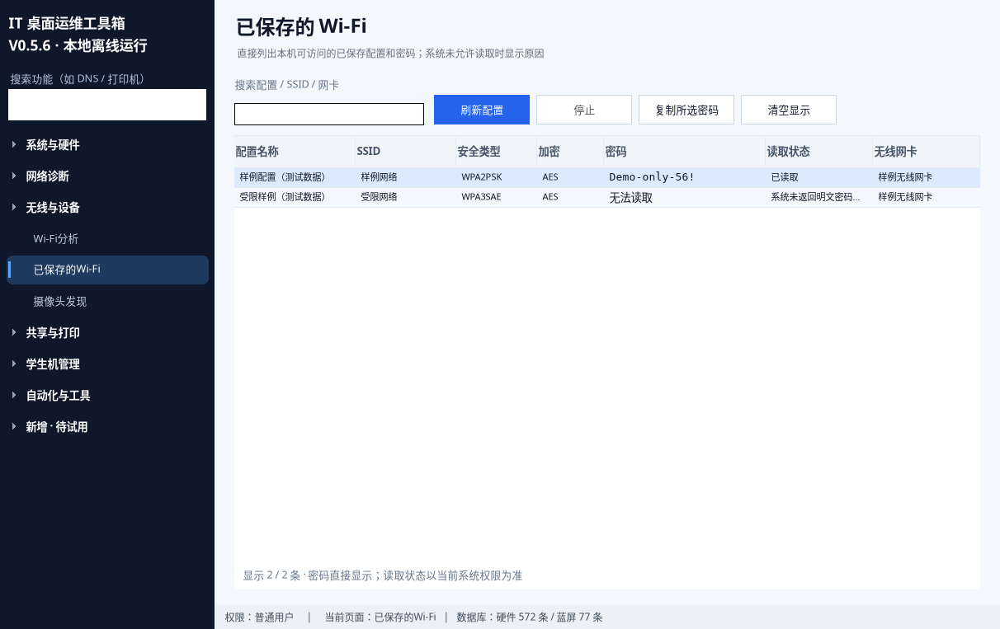
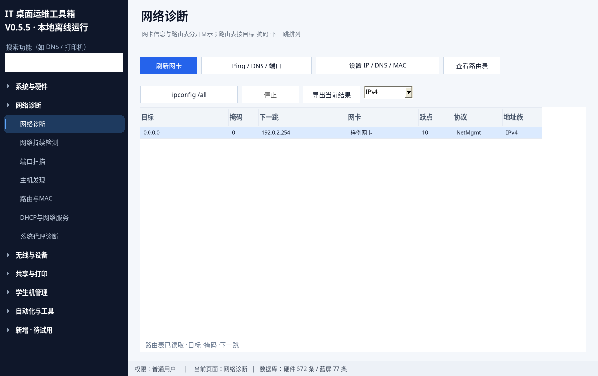
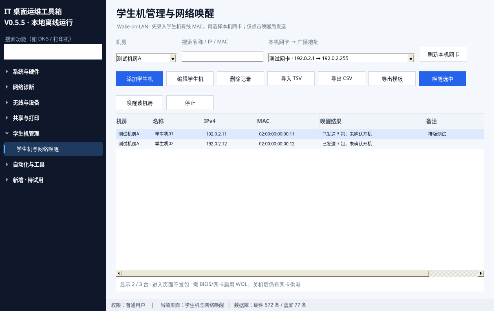
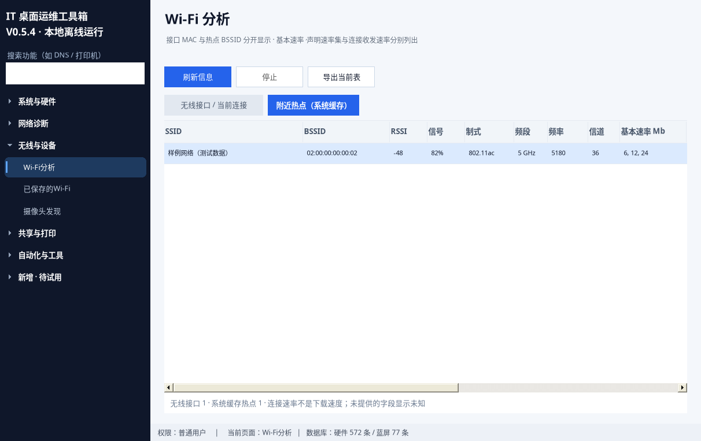
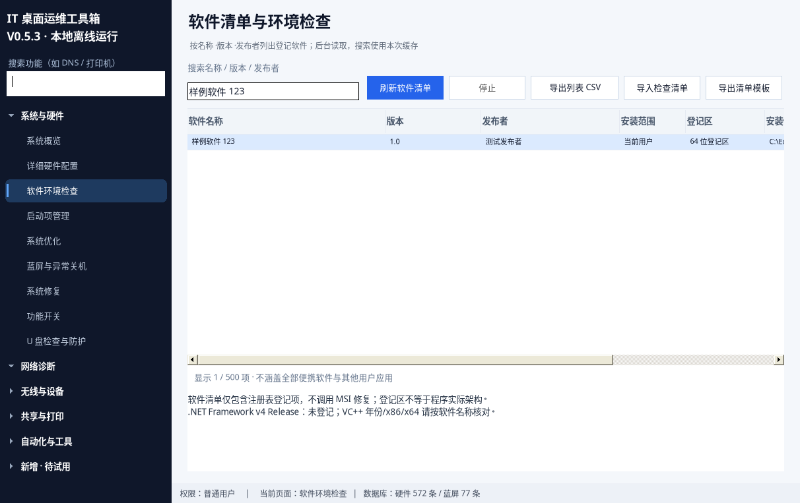
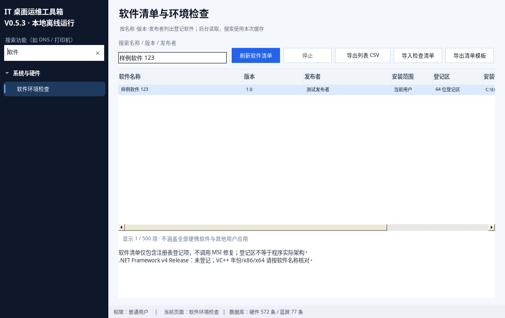
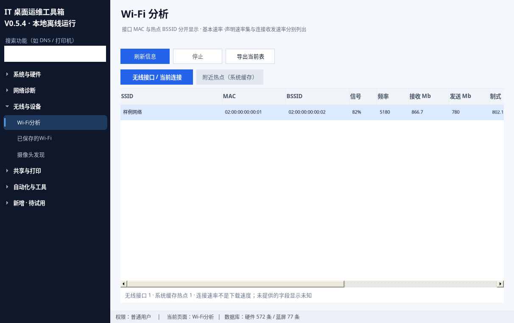

# IT 桌面运维工具箱 V0.5.10

面向 Windows 10 / Windows 11 的 C# WinForms 离线运维工具。V0.5.10 基于 V0.5.9，为 BAT 条件动作增加“条件成立时执行”和“条件不成立时执行”两栏，自动生成分支结构。日常修改递增末位版本号，较大功能/架构变动再升级中间版本号。

## V0.5.10 条件动作直接填写两个分支

入口：**自动化与工具 → BAT 自动化 → 添加动作**。选择“如果网络可达”“如果文件存在”或“如果系统版本”，窗口直接显示两个分支栏：

1. 填写条件本身：网络填写 **目标 IP / 主机名**，文件填写 **文件完整路径**，系统填写 **Build 下限 / 上限**。不需要的参数框会隐藏，网络条件只填一个目标。
2. 在 **条件成立时执行** 栏点击“添加动作”，选择要执行的动作并填写其参数；可以继续添加多个动作，按顺序执行。
3. 在 **条件不成立时执行** 栏设置另一组动作。无需执行的一边可留空，至少一边应有动作；每栏支持编辑、删除、上移、下移，也可添加嵌套条件。
4. 点击“确定添加 / 保存”，自动补齐 `否则` 和 `结束条件`，无需自己逐行拼结构。主流程继续显示展开的动作，双击条件标题即可重新进入两栏编辑。

例如：条件选择“如果网络可达”，目标填 `192.168.1.1`（换成实际网关或电脑 IP），左栏放有回应时的动作，右栏放无回应时的动作。Ping 没回应也可能是目标禁止 ICMP，不能据此认定断网。

编辑在草稿中进行，取消或关闭不改原流程；条件为空、版本范围错误、分支不闭合等会留在窗口提示。新条件保存时检查动作参数与嵌套结构，不执行其中的网络或系统动作。复制、删除、拖动条件/重试块会包含完整块，避免分离开始、否则和结束标记。

继续使用原工作流格式，旧条件块可重建为两栏，原有嵌套和省略否则的结构保留；旧重试块保留，块内动作可在主流程编辑。原有重试和两种 BAT 执行引擎沿用，最多嵌套 8 层。

以下为 Linux/Mono 真实窗口，目标为文档测试地址，两个分支使用等待动作；测试没有执行 Ping 或生成流程中的实际动作：


## 沿用 V0.5.9 的 U 盘、路由表与鼠标坐标

- **U 盘权限**：选盘时直接显示盘符及 NTFS/exFAT/FAT32 等格式；非 NTFS 禁用“NTFS 普通用户只读”和权限恢复，提前说明原因。格式校验在管理员/操作确认之前执行，执行时再次核对；常规失败显示可读原因。刷新和检查结束后仍按格式恢复按钮状态，不会格式化或转换文件系统。
- **非 NTFS 的保护选择**：FAT32/exFAT 没有 NTFS 权限，不能用同一种 ACL 方案。可用原有“开启本机 USB 写保护”，影响当前电脑的 USB 存储写入，需重新插拔并验证，**不会随 U 盘带到其他电脑**；跨电脑只读仍需硬件写保护。新界面不增加磁盘写入、策略或格式化操作。
- **路由与 MAC**：网卡、状态、MAC、IPv4、掩码、IPv6、网关列收紧，网关更靠前；IPv4/掩码/IPv6 仍独立相邻，状态表头横排，完整内容可悬停查看，超宽内容可横向滚动。
- **鼠标坐标**：抓取与 BAT 回放使用物理像素和临时逐显示器 DPI 上下文，结束后恢复线程 DPI 状态；不把读取失败时的逻辑坐标当作物理坐标。支持副屏负坐标，完成抓取后不强行切回编辑器。新增 **3 秒后测试移动**：抓取后先测试目标位置，再保存动作；失败保留原参数并显示原因。更换动作、关闭窗口会取消倒计时，倒计时期间不保存动作。
- 两种 BAT 引擎都使用相同鼠标移动桥接代码；成功调用后核对实际物理位置，超出容差或无法核对时报告失败。模拟检查不能代替真实 Windows 缩放、多屏和输入权限验收；分辨率/显示器布局变化后请重新抓取。

以下为 Linux/Mono 实际窗口，盘符、网卡及坐标均为测试注入；没有修改真实 U 盘权限/策略或移动系统鼠标：




## 沿用 V0.5.8 的教室保存弹窗

扫描时只填网段。扫描完成后，勾选学生机并点击 **保存勾选**，弹出“保存到教室”窗口，填写 **教室名称**，点击 **确认保存** 即可。若此前选中了具体机房，弹窗默认带入该名称，也可以修改。

未勾选设备时先提示选择；教室名为空时留在弹窗中提示补填。点击“取消”或关闭弹窗不写入清单，扫描结果和勾选仍保留，方便继续核对后再保存。已有设备仍保留原分组，新设备才归入填写的教室。

以下为实际窗口，数据为测试样例：




## 沿用 V0.5.7 的扫描机房与右键卸载

**记录一次，以后选机房直接唤醒：**

1. 首次让学生机开机并连接机房有线网络，在“学生机管理 → 学生机与网络唤醒”选择教师机对应网卡，点击 **扫描网段并保存**。
2. 填写网段，点击扫描；结果以全宽表格展示 IPv4、MAC、名称、来源/状态。核对设备后勾选真实学生机，再点 **保存勾选**，在弹窗填写教室名称并确认。可修改新设备名称；打开扫描窗口不会自动扫描、保存或唤醒。
3. 重启工具仍读取原机房清单。以后选中机房，点击 **唤醒该机房**，不必再次扫描或录入 MAC。更换网卡或 MAC 后需更新记录；保存过 IP 的设备若换了网段，也应更新 IP 或留空。

扫描使用 Windows ARP 解析及所选网卡的本机邻居缓存，不做端口探测；原“主机发现”继续仅用 Ping。范围必须在所选接口局域网内，支持 /22–/32、每轮最多 1024 个地址、最多 12 个并发查询；默认对较大网络只取当前 /22 范围，可分段扫描。停止后不再启动后续查询，正在执行的系统 ARP 调用可能需要几秒返回。

ARP 能取得 MAC 不表示一定是学生机，也不保证当前在线；路由器、打印机和缓存结果需要人工核对。未取得 MAC 的行不可保存，同 MAC 对应多个 IP 的行会标记，批量勾选会跳过，核对后可手动选一条。完全关机且无可用缓存的设备可能无法发现，因此首次记录应在设备开机时进行。

清单继续使用 `%LOCALAPPDATA%\ITDesktopToolkit\students-v055.tsv`，升级不更换存储文件。同 MAC 再次扫描只更新 IP，保留原名称、机房和备注；未响应的旧记录保留。新设备保存到填写的机房，总清单最多 500 台。保存清单不自动发送唤醒包，实际 WOL 仍需 BIOS/网卡支持与待机供电。

**软件环境检查右键卸载：**在表格中右键选中软件，点击“卸载所选软件”。程序重新核对该条注册表登记和卸载路径，确认窗口显示软件及将启动的命令，确认后交给原厂卸载程序；取消不会启动。Windows Installer 项使用正常交互卸载。无有效卸载入口的项目可通过“在 Windows 设置中管理”处理。启动卸载程序后保留列表行，完成卸载后手动刷新核对；不会以删除目录或登记项代替卸载。此功能仅管理本机软件。

以下是 Linux/Mono 真实窗口，设备、软件和扫描/发送/卸载结果均由测试注入；没有扫描真实机房、唤醒真实设备或卸载软件：


## 沿用 V0.5.6 的已保存 Wi-Fi

入口：**无线与设备 → 已保存的 Wi-Fi**。

- 直接打开铺满页面的表格，列出 **配置名称、SSID、安全类型、加密、密码、读取状态、无线网卡**。列宽随窗口分配，密码列留足最小宽度，长密码换行；窄窗口可横向滚动。
- 进入即在后台读取并直接显示可访问的明文密码，不再手填配置名或经过单独的确认/密码弹窗。支持刷新、停止、按配置/SSID/网卡搜索，以及复制当前行密码。
- 使用 Windows WLAN 原生接口读取，避免依赖 netsh 中英文文本。仅显示操作系统明确返回的明文；受保护内容不当作密码显示，权限/策略限制、开放网络、企业认证和未保存共享密码分别标明。
- 不修改无线配置，不自动连接网络；密码不写入日志、普通报告或自动保存文件。本页不提供文件导出。清空、刷新或离开页面会清除当前表格并释放当前密码数据引用；复制到剪贴板仅在点击复制时发生。
- 如果当前权限不允许读取，可由有权限的账户在工具箱管理员模式下刷新；组织策略或认证方式仍可能限制读取，软件不绕过这些限制。

以下为 Linux/Mono 实际表格预览，所有配置和密码均为测试样例，未读取真实无线密码：



## 沿用 V0.5.5 的路由与学生机功能

- “网络诊断 → 查看路由表”改为页内表格，与“路由与 MAC → 路由表”共用相同列和转换：**目标、掩码、下一跳、网卡、跃点、协议、地址族**。掩码仍为数字前缀位数，默认路由显示 0，IPv6 支持 0–128；不把目标和掩码拼在一起。
- **系统代理诊断**移至“网络诊断”分类，点击后才读取本机代理；其他四项辅助工具继续位于“新增 · 待试用”。
- 左侧新增独立的 **学生机管理 → 学生机与网络唤醒**，当前为 7 个分类、30 个入口。

以下为 Linux/Mono 实际窗口，地址、学生机和发送结果为明确的测试样例；测试没有向真实学生机发包：






## 学生机清单与 Wake-on-LAN

1. 进入“学生机管理 → 学生机与网络唤醒”，可扫描网段勾选保存，也可手动添加机房、名称、**学生机有线网卡 MAC**、可选 IPv4 和备注。可以编辑、删除本机记录，按机房和关键词筛选；进入页面不会自动发包。
2. 清单自动保存在 `%LOCALAPPDATA%\ITDesktopToolkit\students-v055.tsv`。支持 UTF-8 TSV 模板/导入；同 MAC 更新记录，未导入的原记录保留，最多 500 台。导出 CSV 是当前表格视图及发送结果，已处理公式前缀；CSV 不作为 TSV 直接导入。
3. 选择教师机当前使用的本机 IPv4 网卡，界面显示源地址和根据实际掩码算出的广播地址，不固定使用 `.255`；支持 8–30 位的局域网子网。
4. 选中一台或多台后点“唤醒选中”；或先选择具体机房，再点“唤醒该机房”。**机房唤醒包含该机房全部记录，不受搜索文字限制**；“全部机房”不能直接批量唤醒。
5. 每个唯一 MAC 发送 3 个 UDP 9 魔术包，包间隔 80ms，不自动重试整批。开始前校验整批；填写了 IP 的学生机必须属于所选本机网段，IP 不固定时可留空按 MAC 唤醒。
6. 表格区分“已发送，未确认开机”和发送失败。UDP 交给系统发送不表示设备收到或已经上电；支持停止/切页取消，已发出的包不能撤回，取消中的部分发送数量会保留。

原理是向所选局域网广播标准魔术包（6 个 FF 字节后重复目标 MAC 16 次）。支持 WOL 的学生机网卡在待机供电下识别该包，并通知主板唤醒；不需要安装学生机客户端，也不通过用户名密码远程登录。

需要在实机核对以下条件：

- 学生机 BIOS/UEFI 启用 Wake-on-LAN、PCI-E 唤醒等对应选项；Windows 有线网卡驱动启用魔术包唤醒及允许唤醒。不同硬件对睡眠、休眠、关机状态支持不同，快速启动也可能影响关机唤醒。
- 学生机仍接通电源和网线，关机时网卡仍有待机供电；断开电源/插座关闭无法靠软件唤醒。
- 教师机与学生机位于同一广播域/VLAN，交换机/AP 不阻断所需广播。普通跨 VLAN、公网唤醒不在本版范围，学生机无线网卡的 WoWLAN 也不保证适用。
- 首次记录 MAC 应在学生机开机时扫描或从系统信息取得；关机且无缓存时，不能仅凭 IP 自动得出其 MAC。先用一台启用 WOL 的测试机验证，再使用机房批量操作。

## 沿用 V0.5.4 的表格与导出

- 路由/MAC 保留独立的 **IPv4、掩码、IPv6** 三列，掩码显示 `24`、`20` 等前缀长度，不写成 `255.255.255.0`，也不拼入 IPv4 地址。掩码列收窄，IPv6 紧邻显示；地址族切换只影响网关、DNS、路由和邻居。
- Wi-Fi 的 SSID 列加宽；表头直接使用频率、信道、信号、RSSI 等短名称。基本速率及收发速率用 `Mb`，数值仍为 Mb/s，不换算成 MB/s。频率数值仍为 MHz，RSSI 为 dBm，单位保留在悬停提示中。
- 信号写成 `82%`，百分比跟随数字；RSSI 移到前部，声明速率集放到最后。信号列按数值排序，CSV 也保留百分比。
- 配置预览与导出都按部件压成一行，例如 `内存：金百达 16G 3200MHz ×2`。相同配置的内存条合并数量，不同配置用 ` + ` 连接；未知厂商/频率不猜测。
- 新配置报告为 **V2 可读 TXT**，不再把原始参数逐项导出。系统、CPU、主板、内存、显卡、磁盘各一行，网卡每块一行；保留采集完成后询问导出。仍支持导入 V1 报告，对比时先转为相同的部件摘要，避免仅因文件格式变化出现差异。`G` 是原报告 GiB/GB 容量数字的简写，未修改容量或推算内存频率。

以下均为 Linux/Mono 实际界面，内容为排版测试样例：





[可读配置 TXT 样例](docs/configuration-v054.txt)

## 沿用 V0.5.3 的主要功能

- 每次启动固定进入 **系统概览**，不恢复上次页面。搜索清除图标放入输入框内，有文字时才显示，支持悬停反馈。
- **软件环境检查**直接显示软件名称、版本、发布者、安装范围、登记区、安装位置六列表格；读取放在后台，搜索使用本次缓存，可导出 CSV，手动刷新更新缓存。登记区不等于程序实际架构。
- 启动项的图标/命令列设置合理宽度与最小宽度；表头保持单行，不再挤成竖排。图标在后台读取，同一命令只提取一次，刷新或离开页面释放图像资源。
- 路由/MAC 继续使用直接操作页和横向滚动，IPv4/掩码/IPv6 的最新布局见上方 V0.5.4。
- BAT 保留 ☰ 拖动排序，移除上移/下移按钮，新增 **复制动作 / Ctrl+D**：完整复制所选动作及三个参数，插入下一行并选中，双击后可独立修改。
- 本机配置报告改为系统/Build/架构、整机、CPU、主板、BIOS、内存、显卡、磁盘、网卡和 IP 配置。新报告不查询服务、SMB 策略或共享目录；旧格式报告继续可导入，V0.5.4 导出部件摘要。采集成功后询问是否导出，选择否保留窗口中的结果，关闭采集窗口会请求取消。
- “新增 · 待试用 → 网络配置核对”的表格铺满可用宽度，说明列留出更多空间；除代理已移至网络诊断外，其他四项试用功能继续留在原分类。

性能方面：启动时的大型编号库改在后台加载，窗口先显示；重载使用新数据库实例，扫描保留自己的读取实例。软件列表批量回填、缓存搜索；报告一次更新全文；硬件 WMI 对象及时释放，离开硬件页会请求停止后续查询。已通过慢数据库任务下的窗口可用性检查；没有 Windows 实机耗时数据，不宣称固定加速比例。

以下为 Linux/Mono 实际窗口，软件与自动化内容为明确的测试样例：






## 网络辅助工具（V0.5.2 起）

系统代理诊断位于 **网络诊断**，其余四项位于 **新增 · 待试用**；进入页面不会自动执行。点击查询/读取后显示结构化表格，支持停止、切页取消和 CSV 导出，待逐项试用后再决定是否保留。

| 工具 | 用途与边界 |
| --- | --- |
| DNS 记录查询 | A、AAAA、CNAME、MX、TXT、NS、SRV、PTR；可指定 DNS 服务器 IP，支持国际化域名、IPv4/IPv6 反查，不修改 DNS 设置。使用 Windows Resolve-DnsName |
| ICMP 路由跟踪 | IPv4，每跳一次标准 ICMP，默认最多 16 跳、上限 30 跳，单跳超时 1200ms；不进行 TCP/SYN 探测，星号/超时不能证明设备故障 |
| 本机连接与监听 | TCP 连接/监听、UDP 本机绑定、PID/进程；默认只列 TCP 监听项，UDP 始终列本机绑定，每种协议最多 500 行，不测试远端可达性 |
| 系统代理诊断 | 当前用户代理/PAC 设置、四项常见代理环境变量、WinHTTP 配置；隐藏 URL 凭据和路径/参数，不下载 PAC、不探测 WPAD、不更改设置 |
| 网络配置核对 | 本机已连接接口的 IPv4、APIPA、掩码、网关子网、DNS 配置和本机重复地址；不发 ARP/Ping，不把本机配置检查当作局域网冲突检测，暂不核对 IPv6 |

DNS 查询和 ICMP 路由跟踪在点击执行后会发送网络请求；使用主机名跟踪还会解析名称。其余三项仅读取本机。原有 **主机发现仍然只用 ICMP Ping**，不依据 TCP 端口判断主机是否在线。Ping/路由跟踪也可能被网络管理平台记录，软件不能保证不触发组织策略告警。


## 离线硬件库扩充

- 收录 **406 条主板型号名称精确规则**与 **23 条内存/SSD 家族前缀规则**，连同原库共 **572 条硬件规则**。主板名称来自 LibreHardwareMonitor，不从型号字符串猜制造商或 PCB 修订。
- 附带 PCI 2026.11.15 快照：**2526 个厂商、21819 个设备 ID**；USB 2026.06.26 快照：**3427 个厂商、20537 个设备 ID**。可补充显卡、网卡、存储控制器、USB 外设等芯片名称，不能保证每个零售型号、显存或整机 SKU 均可确定。
- 型号名称精确匹配优先于家族前缀和普通关键词，详情显示规则来源与匹配依据；家族规则不推断容量/频率/颗粒。未知设备保留系统原始信息。
- 新库为独立版本文件，不覆盖用户原有 `hardware_models.tsv`、`pci.ids`、`usb.ids`；用户 ID 条目在上游快照后加载，同 ID 优先。编译只补入运行目录缺失文件。
- 来源、哈希和许可见 [Database/SOURCES-v052.md](Database/SOURCES-v052.md)，完整许可及主板提取源文件随包附带。应用不自动联网更新数据库。以上数量为原始附带库，用户编辑后会变化。

## 导航与界面

左侧改为 **7 个可折叠分类、30 个二级入口**，默认只展开一个分类；顶部支持中文名称和关键词搜索，例如 `DNS`、`WiFi`、`打印机`、`MAC`。搜索只筛选入口，不自动执行检查；按回车打开首个匹配入口，清空搜索恢复分类。程序在本次运行中保留折叠状态；重新启动固定打开系统概览。

| 分类 | 功能 |
| --- | --- |
| 系统与硬件 | 系统概览、硬件配置、软件环境、启动项、系统优化、蓝屏/异常关机、系统修复、功能开关、U 盘防护 |
| 网络诊断 | 网络配置/连接测试、持续检测、端口扫描、主机发现、路由与 MAC、DHCP/服务检查、系统代理诊断 |
| 无线与设备 | Wi-Fi 分析、已保存的 Wi-Fi、ONVIF 摄像头发现 |
| 共享与打印 | 共享文件夹、SMB/NTFS 权限、打印机与服务 |
| 学生机管理 | 网段扫描保存、机房清单、按 MAC 网络唤醒 |
| 自动化与工具 | BAT 自动化、电脑配置对比、Windows 管理入口、离线数据库 |
| 新增 · 待试用 | DNS 记录查询、ICMP 路由跟踪、本机连接与监听、网络配置核对 |

以下沿用 V0.5.1 排版预览；上方新图展示 V0.5.2 试用分类。截图为 Linux/Mono 实际界面预览，Windows 的字体和窗口装饰可能略有不同：


端口扫描、主机发现直接进入表格与输入区；路由/MAC、Wi-Fi 分析进入后自动读取，不再多点一次“打开”。统一字体、配色、按钮和表格，旧“安全与维护”展开状态会迁移到“系统与硬件”。切换页面会取消该页进行中的读取/检测。

Wi-Fi 表格预览（以下是用于排版测试的样例数据，不是真实无线扫描结果）：




常用网络工具的使用方法：

- **端口扫描**：默认载入 **125 个常用 TCP 端口**，涵盖文件共享、邮件、远程管理、Web、数据库、打印等，也可手动填写端口或范围。端口列表与常见服务名位于 `src/CommonPorts.cs`；这是常用预设，不包含所有可能的服务端口或 UDP 检测。仅验证 TCP 握手，不发送应用数据；区分开放、拒绝、超时与连接错误。每次最多 1024 个端口，并发 1–32，单次连接超时 100–10000 毫秒。
- **主机发现**：输入 IPv4 或 `/24` 至 `/32` 的 CIDR 网段，例如 `192.168.1.0/24`。只执行 **ICMP Ping**，不再尝试任何 TCP 端口；展示响应状态与往返延迟。最多 256 个地址，无响应不等于离线，关闭 ICMP 的设备可能不响应。
- **路由与 MAC**：进入即只读加载，分别用“网卡/IP/MAC”“路由表”“邻居/ARP”三张表显示；IPv4 和 IPv6 同行分列，掩码另列位数；地址族切换控制网关、DNS、路由和邻居，支持横向滚动。邻居缓存不是完整设备清单，MAC 前缀不能证明整机品牌。
- **DHCP 与网络服务**：显示当前 DHCP 配置、服务器、租约和相关服务；可分别测试 DNS、TCP、HTTP。HTTP 仅发送 HEAD，保持证书校验，不自动带账号密码，不跟随跳转。401/403/405 等也属于服务响应，不代表业务正常。DHCP 页面只读取本机信息，不发送租约申请，不能排除其他 DHCP 服务器或冲突。
- **Wi-Fi 分析**：通过 Windows WLAN API 结构化读取，进入即加载。默认显示附近热点表，可切换到无线接口/当前连接表。分别列出接口 MAC、热点 BSSID、网络类型、无线制式、频段、频率（MHz）、信道、信号（% / dBm）、基本速率、声明速率集和当前收发速率（Mbps）。不依赖 `netsh` 的中英文排版。
  - 附近热点来自系统缓存，刷新读取不保证缓存立即更新；不自动连接或更改无线配置。
  - 基本速率来自热点速率集的基本标记，声明速率集为系统报告的支持速率；二者不等于当前连接速率或实际下载速度，也不保证包含所有现代 PHY 的 MCS 能力。
  - 当前接口收发速率单独列出，不用热点声明速率集冒充实时速率。未提供的数据明确显示“未知”；非 UTF-8 SSID 用十六进制保留原始字节。
  - 部分 Windows 版本要求开启位置服务，读取也可能受服务状态、网卡和组织策略限制。失败会显示原因，不以空表冒充成功。
  - 表格支持排序和横向滚动，CSV 按可见列顺序导出，并处理网络名称导致的公式注入。
- **已保存的 Wi-Fi**：进入即用全宽表格列出配置及系统允许读取的明文密码，无额外确认弹窗；受限项显示原因，支持搜索、刷新、复制密码和清空显示。该页不提供文件导出，普通报告不包含密码。
- **摄像头发现**：选择本机局域网 IPv4 网卡，发送 ONVIF WS-Discovery 组播，等待 5 秒。只显示与当前请求匹配的设备声明，不登录、不自动访问声明地址。回复未经认证，不能仅凭声明认定设备身份；跨 VLAN、组播/防火墙限制或不支持发现的设备可能没有结果。

检查均支持停止。扫描过程中只启用停止按钮，避免任务重叠；关闭窗口会先请求停止。除已保存 Wi-Fi 密码页外，结果可导出；未完成的目标不产生检测结论。本版未增加数据包抓包、主动 DHCP 服务器发现、会话压力测试、AI 助手；这些需要另行设计依赖和验证，菜单没有空入口。

## 编译与启动

1. 下载并完整解压源码包，不要只复制 `src` 文件夹。
2. 在 Windows 10/11 上运行 `Build_Only.bat` 编译，或运行 `Build_And_Run.bat` 编译并启动。
3. 程序位于 `build/ITDesktopToolkit.exe`。移动程序时须同时携带 `build/Database`。
4. 普通检查不主动提权；修改打印队列、系统设置或 USB 写保护时按界面提示使用管理员权限。

编译使用 Windows 自带 .NET Framework C# 编译器，脚本会检查编译器是否存在；不需要还原 NuGet 包。运行依赖 Windows PowerShell 5.1 与相应的 Windows 管理接口。

## 沿用 V0.4.6 的功能

- **所选 NTFS U 盘普通用户只读**：在“U 盘检查与防护”中选盘，设置或恢复权限。设置前备份原权限；普通 Windows 用户可读取，管理员仍可写入。只支持 NTFS，不格式化 U 盘；严格跨电脑只读仍需硬件写保护。
- **取得指定文件夹权限**：选择文件夹，递归把 Administrators 设为所有者并授予完全控制。操作结果会列出失败项。
- **BAT 清空回收站**：添加“清空当前用户回收站”动作，永久清理 BAT 实际运行账户在所有驱动器的回收站。此动作不能放入自动重试块。

## 沿用 V0.4.5 的功能

### 电脑配置对比

入口：**自动化与工具 → 电脑配置对比 → 打开电脑配置对比**。

- 在正常电脑和异常电脑上分别点击“采集本机报告”；成功后询问是否立即导出，选择否则可继续查看，稍后用“导出本机对比报告”保存。
- 在同一个窗口导入左、右两份报告，点击“比较两份报告”。
- 按系统/Build/架构、整机、CPU、主板、内存、显卡、磁盘和网卡摘要逐行对比；内存合并厂商、容量、报告频率与数量，不散列插槽或零件号。新报告没有服务、SMB 策略或共享目录；可选设备读取失败保留提示，系统或 CPU 关键信息失败不能当作成功。
- 差异结果可另存为文本。新版对比报告为可读的 V2 TXT，仍可导入旧版 V1 编码报告；报告包含电脑名、MAC 和 IP 地址，分享前请检查内容。

这是用于排障的报告对比，不会自动修改配置或同步两台电脑，也不提供配置快照还原。

### 打印机专项诊断

入口：**共享与打印 → 打印机与服务 → 打印机专项诊断**。

- 查看默认打印机、脱机状态、驱动、端口和各打印机的排队任务。
- 输入打印机 IP/主机名与端口（默认 `9100`）测试 TCP 连通性，不发送打印数据。
- 输入诊断报告中的准确打印机名称，经确认后取消该打印机的全部排队任务，不清空其他打印机队列。
- 导出诊断结果。取消任务不能撤销；TCP 可连接不等于驱动、耗材或出纸机构正常。

### 网络质量持续检测

入口：**网络诊断 → 网络持续检测**。

- 输入网关、内网服务器或外网目标，以逗号分隔，最多 8 个主机名/IP。
- 设置采样轮数（1–10000）和轮间隔（1–3600 秒），点击开始。
- 每轮并行检测，之后等待轮间隔；记录带时区时间、响应状态和延迟。
- 实时显示最近 20 条，统计无响应/错误比例、最小/平均/最大延迟、相邻成功采样的平均延迟变化。
- 支持停止以及导出完整 CSV。开始新一轮前会提示清空上一轮记录。

检测使用 ICMP。主机禁用 ICMP、名称解析失败、本地权限或网络故障都可能造成检测失败，不能仅凭无响应断定目标断网。DNS 解析耗时也可能影响停止速度。

### 软件清单与环境检查

入口：**系统与硬件 → 软件环境检查**。

- 进入即后台读取本机/当前用户、32/64 位注册表，六列表格展示名称、版本、发布者、范围、登记区、安装位置；显示 .NET Framework v4 Release，VC++ 年份/架构按清单项核对。
- 搜索在已读取缓存中筛选；再次进入沿用缓存，点击“刷新软件清单”重新读取，支持停止、列表 CSV 导出。
- 不使用可能触发 MSI 修复的 `Win32_Product` 查询。
- 支持导入 UTF-8 软件要求清单、导出模板与检查结果。

清单每行格式为：`软件名称关键词<Tab>最低版本`，最低版本可省略。例如：

```text
Google Chrome	120.0
Microsoft Visual C++
```

关键词匹配不区分大小写。检查结果区分符合、缺失、版本偏低及版本需人工核对。登记清单不能覆盖全部便携软件和其他用户的应用；检查特定运行库架构时，应使用包含年份、x86/x64 的具体名称关键词。

### BAT 条件、分支与失败重试

入口：**自动化与工具 → BAT 自动化 → 添加动作**。条件动作使用上方两栏编辑，以下说明底层展开流程及重试参数，原有工作流文件格式继续兼容。

| 新动作 | 参数与行为 |
| --- | --- |
| 如果文件存在 | 文件完整路径；只判断文件，不判断文件夹，两栏分别设定存在/不存在时的动作 |
| 如果网络可达 | 目标 IP / 主机名为单个目标，两栏按 ICMP 是否有回应分支 |
| 如果系统版本 | Build 下限及可空的上限；例如 Win11 初始 Build 为 22000 |
| 否则 / 结束条件 | 两栏编辑保存时自动生成；旧流程仍支持省略否则，每块最多一个 |
| 重试开始 / 重试结束 | 参数 1 为总尝试次数（1–10，默认 3），参数 2 为失败后等待秒数（1–300，默认 2） |
| 检查文件存在 | 文件不存在则报错，适合放在重试块中等待外部程序生成结果 |
| 运行程序并等待 | 参数 1 为路径，参数 2 为启动参数，参数 3 为超时秒（1–86400，默认 60）；非零退出码或超时算失败 |

示例：

```text
如果文件存在       D:\Tools\check.exe
  重试开始         3                 2
    运行程序并等待 D:\Tools\check.exe  /check  60
  重试结束
否则
  运行程序         notepad.exe
结束条件
```

条件/重试最多嵌套 8 层，保存及导出时检查结构是否闭合。失败重试会重新执行整个块，使用者须确认其中操作可重复执行；格式化、删除和清空回收站动作不能放入重试块。程序超时仅尝试结束主进程，不能保证结束其启动的全部子进程。

### U 盘检查与本机防护

入口：**系统与硬件 → U 盘检查与防护**。按本版需求，**不提供资料恢复、自动删除、格式化或自动清理**。

只读检查：

- 从 Windows 识别的可移动存储中选择 U 盘，检查隐藏属性、`autorun.inf`、文档伪装的双扩展名、同名文件夹/程序。
- 读取 `.lnk` 快捷方式指向和参数，提示调用命令/脚本解释器的情况，不执行目标。
- 为不超过 64 MiB 的可疑文件计算 SHA-256；跳过重解析点，最多遍历 50000 个文件/目录、保留 5000 条发现。
- 支持中止、导出报告、按盘符查看 Defender 历史，以及导入其他杀毒软件的文本报告供人工核对。
- **可疑迹象不等于病毒确诊，未发现迹象不等于安全。** Defender 历史可能缺失、受权限限制，也可能对应过去使用同一盘符的其他设备。

本机防护：

- **关闭当前账户自动播放**：设置该账户 `NoDriveTypeAutoRun=255`，影响所有驱动器的自动播放，可能需要重新登录。
- **开启本机 USB 写保护**：管理员设置本机 `StorageDevicePolicies\WriteProtect=1`，通常需要重新插拔，可能影响其他 USB 存储设备。
- 修改前保存原值，可分别还原首次保存的原策略值；还原按钮恢复的是策略设置，不是 U 盘文件。
- 备份按当前运行账户保存在 `%LOCALAPPDATA%\ITDesktopToolkit`，还原时请使用相同账户。

NTFS U 盘权限：选中可移动 U 盘后，可以递归把普通用户设为读取和运行、SYSTEM 设为所有者并保留完全控制、Administrators 保留完全控制。修改前会将原权限备份到当前账户的 `%LOCALAPPDATA%\ITDesktopToolkit`，可通过“恢复所选 U 盘原权限”还原；全部恢复成功后删除备份以便再次设置。只支持 NTFS，不格式化 U 盘；遇到重解析点或无法读取的权限会停止。系统目录 `System Volume Information` 和 `$RECYCLE.BIN` 不参与递归修改。此设置只限制遵守 NTFS 权限的 Windows 普通账户，管理员仍可写入或修改权限。也可选择指定文件夹，递归把 Administrators 设为所有者并授予完全控制；操作结果会显示失败项。

**本机软件写保护仅影响设置过的电脑，不会跟随 U 盘到其他机房电脑，也不阻止手动执行恶意程序。** 组织策略、设备驱动可能影响生效，写入策略成功后仍应重新插拔并验证。需要跨电脑阻止写入时，应选择带物理写保护开关的设备。

## 保留的原有功能

系统与硬件概览、显示器/EDID、网络配置与诊断、蓝屏/异常关机、系统修复、启动项、电源、SMB 共享模式与权限、NTFS 权限、输入法、鼠标键盘自动化及离线故障库。

本版未添加资产管理、维护 U 盘启动器或配置快照功能。

## 测试与验证

当前 Linux 云环境已完成：完整源码 Mono 编译、C# 5 语法编译检查、**348 项检查（原有功能/脚本 50 + 网络工具 34 + 工作区/WLAN 数据 49 + 新增工具/数据库 36 + 桌面配置/列表 34 + 学生机扫描/唤醒 41 + 界面导航 104）**，以及原有离线数据库加载/查询冒烟检查。当前只剩原有 `NetworkConfigService.cs` 的 1 条未使用变量警告。

本次新增检查覆盖三类条件的双分支组合、嵌套边界、旧流程兼容、草稿独立性、整块移动/复制、工作流保存读取，以及真实窗口添加分支动作、隐藏无关参数、错误阻止提交、重开条件和取消不改原流程。条件编辑测试不执行 Ping、程序或分支内动作。此前检查覆盖文件系统权限支持、exFAT/NTFS 选盘与刷新按钮状态、紧凑网卡表、物理坐标倒计时/负坐标/测试移动/失败保留参数/切换取消。鼠标桥接代码用模拟原生接口编译执行，验证两种 BAT 引擎共用代码、DPI 上下文恢复、拒绝无保证的逻辑坐标回退及位置核对失败；没有调用真实鼠标、U 盘权限或策略接口。此前检查覆盖保存弹窗默认教室、未确认不写入、取消保留勾选、空名称不保存，以及确认后保存并选中教室。此前检查覆盖扫描范围/并发/停止、ARP 与缓存状态区分、重复 MAC、保留原名称/分组/未响应记录、扫描保存后重新进入读取、选机房无需重扫唤醒，以及卸载路径解析、MSI 交互参数、右键筛选项身份与取消不启动。扫描和卸载均使用模拟，不执行真实 ARP 扫描或卸载；Windows 原生接口仍待实机验收。原有检查覆盖已保存 WLAN 配置 ABI/列表、XML 实体阻断、明文与受保护密钥区分、权限状态、停止时丢弃迟到结果及全宽表格；无线测试使用固定演示密码，不调用真实密码读取。原有检查覆盖路由目标/前缀拆列、WOL 包格式、实际掩码广播、清单原子保存/重复合并、整批预检/取消、学生机真实窗口新增编辑与机房范围。WOL 发送采用模拟传输验证，不向真实学生机发包；实机唤醒能力仍需硬件验收。原有检查覆盖 CIDR/端口边界、并发上限、取消、TCP 无数据握手与连接关闭、HTTP HEAD/不跟随跳转/取消、命令退出码与错误输出、ONVIF 回复关联及禁用外部实体、菜单搜索/折叠/位置记忆、WLAN 原生结构大小和偏移、频率与速率换算、纯 Ping 调度，以及直接页面/自动读取/真实回环 TCP 扫描/快速切页取消。界面测试通过 Xvfb/Mono 实际创建窗口并生成截图，不等同于 Windows 设备接口验收。当前 Linux ICMP 组件缺失的探测错误会如实记录，不计作 ICMP 连通成功。

Windows 自动验证入口（使用系统 .NET Framework C# 编译器）：

```powershell
powershell -NoProfile -ExecutionPolicy Bypass -File tests\Run-Windows.ps1
```

仓库新增 `.github/workflows/windows-validation.yml`，推送 main 或创建 PR 后在 Windows runner 上编译并运行七套测试、解析生成的 PowerShell，再执行条件/重试及 DNS/连接表格/硬件配置报告模拟用例。新增模拟用例替换系统查询，不访问真实 DNS 或远端服务。可在 GitHub Actions 查看实际结果，不能用工作流文件的存在代替运行通过。测试不会修改 USB 策略、打印队列或读取真实 Wi-Fi 密码；导航测试会保存并恢复其使用的导航配置文件。

Linux 检查入口为 `tests/run-mono.sh`；在已有 Mono 开发环境与虚拟显示的云工作区中，设置 `DISPLAY` 后运行 `tests/run-navigation-ui-mono.sh`。这两个脚本使用当前云环境 `/workspace/cloud-setup` 中的工具链。

当前云主机没有 Windows。WLAN 数据解析使用原生格式测试缓冲区验证，UI 截图中的无线数据为测试样例，不能代替真实无线网卡/权限验收。真实无线接口/密码权限、DHCP/路由管理接口、ONVIF 设备、U 盘策略及打印机仍需实机验收，步骤见 [tests/Windows验收.md](tests/Windows验收.md)。

V0.4.6 的回收站动作仅在自动化用例中验证生成与结构，测试不会真正清空回收站；本次合并保留所选 NTFS U 盘只读、原权限恢复与指定文件夹权限取得功能。

## 文件与日志

- 原始离线库：`Database/`；运行时库：`build/Database/`，编译不会覆盖其中已有的用户编辑。
- 旧导航状态文件 `navigation-v050.txt` 不再读取或写入；启动固定显示系统概览。
- 学生机清单：`%LOCALAPPDATA%\ITDesktopToolkit\students-v055.tsv`；编译不覆盖本机清单。
- 本地日志与策略原值备份：`%LOCALAPPDATA%\ITDesktopToolkit`。
- 本版文件校验：`SHA256SUMS.txt`。这是 V0.5.10 的完整发布基线，不能与旧版本哈希混用。
- 版本演进与历史记录：[版本更新记录_累计.txt](版本更新记录_累计.txt)。
